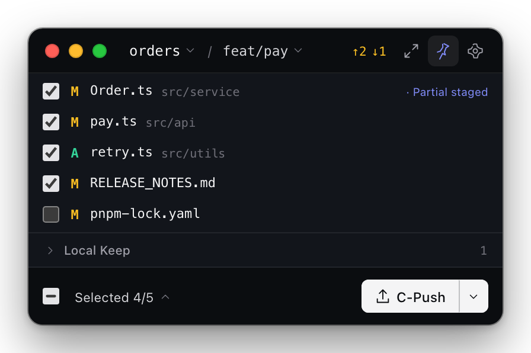

<p align="center">
  
</p>

<h1 align="center">Picket</h1>

<p align="center">
  <strong>A macOS desktop Git Agent for scoping, reviewing, splitting, committing, and pushing changes in one click.</strong>
</p>

<p align="center">
  <strong>English</strong> · <a href="README.zh-CN.md">简体中文</a>
</p>

<p align="center">
  macOS 14+ (Apple Silicon) · MIT License · English &amp; 简体中文 UI
</p>

---

**Picket** sits quietly beside your IDE and handles the noisy last mile of Git. Instead of manually untangling mixed edits, writing repetitive commit messages, or risking half-finished drafts, you pick the files you want to ship, optionally review them or preview the commit plan, and click **C-Push** — Picket splits related changes into clean commits, writes messages, commits strictly within your selected scope, and pushes to your remote.

It pauses to ask only when a real decision is needed, leaving unselected files, **Local Keep** paths, and unstaged IDE drafts completely untouched.

<table>
  <tr>
    <td align="center" width="50%">
      <br />
      <sub><strong>Main Workbench</strong> · Exact-scope selection, Local Keep &amp; editable Preview Plan</sub>
    </td>
    <td align="center" width="50%">
      <br />
      <sub><strong>Code Review</strong> · Structured findings with one-click IDE jump</sub>
    </td>
  </tr>
</table>

## Highlights

### One-Click C-Push & Editable Commit Plans
- **Smart split, commit & push**: Select your changes and click **C-Push**. Picket analyzes your authorized diff, groups related files into Conventional Commits, commits each group cleanly, and pushes to the remote branch.
- **Ask only when it matters**: No confirmation popups on every commit. Picket pauses only for genuine ambiguity (such as unclear file ownership, sensitive files, or a missing upstream target).
- **Optional `+ Prompt` instructions**: Add brief guidance (for example, *"split lockfile separately"* or *"keep messages concise"*) to steer commit planning and code review without widening your authorized scope.
- **Editable Preview Plan**: Click **Preview Plan** whenever you want to inspect and edit commit messages before shipping. Valid edited plans are committed verbatim on **C-Push** and automatically flagged as **Outdated** if files or selections change.

### Exact-Scope Git Safety & Local Keep
- **Selection never mutates `.git/index`**: Checking or unchecking files in Picket only controls the active scope — it never runs `git add` or `git reset` behind your back.
- **Partial staging preserved**: When a file has both staged and unstaged edits, Picket commits only the staged hunks by default and leaves your unstaged IDE drafts byte-for-byte intact.
- **Zero leakage from unselected staged files**: Files staged in Git but unchecked in Picket are never swept into a commit.
- **Local Keep**: Drag files (or right-click single or multi-selected rows) into the bottom **Local Keep** group to keep local-only edits out of **Select All**, **C-Push**, **Preview Plan**, and **Code Review** across every worktree of that repository — without touching `.gitignore`, `.git/info/exclude`, `skip-worktree`, or `assume-unchanged`.

### On-Demand Code Review
- **Review selected changes before pushing**: Run structured AI code review against the exact selected scope, optionally carrying your `+ Prompt` context.
- **Actionable findings**: Issues are categorized as **High** or **Suggestion** with one-click navigation straight to the file and line number in your IDE.
- **Honest coverage & incremental re-review**: Lockfiles, binaries, and oversized diffs are explicitly reported as skipped rather than silently marked clean. When reviewed files change, click **Re-review Changed Files** to refresh only what changed.

### Branches, Worktrees, Sync & Controlled Recovery
- **IDEA-style branch menu**: Switch local branches, check out remote tracking branches, or jump directly to linked worktrees from one compact menu. `main` and `master` carry a lightweight **Protected** badge while allowing direct pushes; detached `HEAD` prompts you to switch to a local branch first.
- **Lossless Pull & Rebase**: Pull and rebase remote updates while preserving non-overlapping staged and unstaged changes — without risky auto-stashing.
- **Retry Push only**: If local commits succeed but pushing fails, your commits and prompt stay intact; clicking **Retry Push** pushes existing commits without re-creating them.
- **Controlled conflict handling**: If a rebase hits a conflict, you can explicitly authorize the Agent to merge the active conflicted files (validated for conflict markers and path boundaries) or open the conflict in your IDE and return to Picket for automatic reconciliation.
- **Safe by default**: Picket never auto-force-pushes, discards uncommitted work, or silently rewrites published remote history.

### Pinned Compact Mode & IDE-First Workflow
- **Designed to stay beside your IDE**: Toggle **Compact Mode** (`400 × ~86` floating 2-row bar with quick drawers for projects, branches, remote pull & rebase, and file selection), **Always-on-Top Pin**, and **Settings** independently at any time from the permanent top-right toolbar.
- **Unobtrusive notifications**: When Picket is unfocused, native macOS notifications alert you only when your input is needed (decisions, conflicts, or push failures) without stealing focus or resizing the window.
- **Seamless external IDE integration**: Auto-detects installed editors (`IntelliJ IDEA`, `RustRover`, `WebStorm`, `VS Code`, `Cursor`) to open files, diffs, staged diffs, review lines, and conflict merges.
- **Bilingual experience**: Instant **English** / **简体中文** UI switching, plus per-project **Preferred Editor** and **Commit Message Language** settings (Conventional Commit prefixes like `feat` and `fix` remain in English).
- **Quiet in-app updates**: Single-channel update checks via **Settings → About & Updates** with a subtle indicator dot when a newer signed release is available, live download progress, Ed25519 signature verification, active-Git-task safety guards, and graceful restart (plus direct GitHub Releases fallback).

<table>
  <tr>
    <td align="center" valign="middle" width="50%">
      <br />
      <sub><strong>Pinned Compact Mode</strong> · Floating 2-row bar (<code>400 × ~86</code>)</sub>
    </td>
    <td align="center" valign="middle" width="50%">
      <br />
      <sub><strong>Quick Drawer</strong> · Toggle files, switch branches, or pull &amp; rebase inline</sub>
    </td>
  </tr>
</table>

## Typical Workflow

1. **Open a local repository**: Launch Picket and open any local Git repository (linked worktrees are detected automatically).
2. **Pick your scope**: Normal changes are selected by default; uncheck anything not ready yet or drag local-only files into **Local Keep**. Double-click any file or click **Diff** to inspect it in your IDE.
3. **Review or preview (optional)**: Run **Code Review** on the selected scope, add brief extra instructions via **+ Prompt**, or click **Preview Plan** to inspect and tweak commit messages.
4. **Ship with C-Push**: Click **C-Push**. Picket splits, commits, syncs if needed, and pushes — notifying you only if a decision, conflict, or push retry needs your attention.

## Supported Providers & Editors

### Model Providers

Configure each provider connection once (base URL & API key), then add as many models under that connection as you need. Picket connects through an isolated bundled Pi Core runtime.

| Provider | Default API Format | Notes |
| --- | --- | --- |
| **Anthropic** | Anthropic Messages (`/v1/messages`) | API key stored in `~/.picket/credentials.json` (`0600`) |
| **OpenAI** | OpenAI Responses (`/responses`) | Also supports Chat Completions |
| **DeepSeek** | OpenAI Chat Completions (`/chat/completions`) | API key stored in `~/.picket/credentials.json` (`0600`) |
| **Ollama (Local)** | OpenAI Chat Completions (`/chat/completions`) | Connects to local server (e.g. `http://127.0.0.1:11434/v1`), no API key required |
| **Custom Compatible** | Configurable | Supports OpenAI Chat Completions, OpenAI Responses, and Anthropic Messages |

### External IDEs

Picket automatically detects installed IDEs on macOS and lets you pick a preferred editor per project:

- **IntelliJ IDEA**
- **RustRover**
- **WebStorm**
- **Visual Studio Code**
- **Cursor**

## Security & Privacy

- **Isolated local data & credentials (`~/.picket/`)**: All Picket data lives under `~/.picket/` (`0700` directory, `0600` files). API keys are stored strictly in a dedicated `~/.picket/credentials.json` (`0600`) file keyed by provider connection — never written to `models.json`, `workbench-state.json`, session history, logs, or frontend state, and without repeated macOS Keychain prompts across ad-hoc test builds.
- **Configure a provider once, add models on demand**: Child models inherit their parent connection's endpoint and API key automatically without re-entering secrets; rotating a connection key updates every model under that connection at once. Viewing a saved full key in **Edit Connection** still requires macOS device authentication (**Touch ID** or login password) and automatically hides after 30 seconds or when the window loses focus.
- **Zero hidden credentials**: Picket starts with zero repositories and zero models; it never reads shell environment keys or external developer logins.
- **Controlled local Git execution**: All Git writes are verified and executed by the native Rust desktop layer — models never run arbitrary shell commands against your repository.
- **Uses your existing Git auth**: Remote push and fetch reuse your existing local Git / SSH credentials with no extra account login required.

## Getting Started

> **Platform note**: Picket currently supports **macOS 14.0+ on Apple Silicon (`arm64`)**. Pre-built signed `.dmg` releases are not published yet; build and run locally from source below.

### Prerequisites

- macOS 14.0 or later on Apple Silicon (`arm64`)
- Xcode Command Line Tools (`xcode-select --install`)
- [Node.js](https://nodejs.org/) `24.17.0`
- [pnpm](https://pnpm.io/) `10.28.1`
- [Rust](https://rustup.rs/) via `rustup` (toolchain pinned in [rust-toolchain.toml](rust-toolchain.toml))

### Run or Build from Source

```bash
git clone https://github.com/dpbs-715/Picket.git
cd Picket
pnpm install --frozen-lockfile

# Run in desktop development mode
pnpm desktop dev

# Or build the standalone macOS .app bundle
pnpm desktop build
```

The packaged application is written to `src-tauri/target/release/bundle/macos/Picket.app`.

### First Launch

1. Click **Open Local Repository…** to add a Git working directory.
2. Click **Configure Model** (or open **Settings**) to add your preferred model provider and test the connection.
3. Select the files you want to ship and click **C-Push**.

## Development & Contributing

Built with **Tauri 2 (Rust)**, **React + TypeScript**, and an isolated **Pi Core** sidecar process.

- Read [AGENTS.md](AGENTS.md) for architecture details, invariants, verification scripts, and coding guidelines.
- Run `pnpm check` to execute TypeScript checks, Node tests, Rust formatting/Clippy checks, and Rust integration tests.

## License

Released under the [MIT License](LICENSE).
