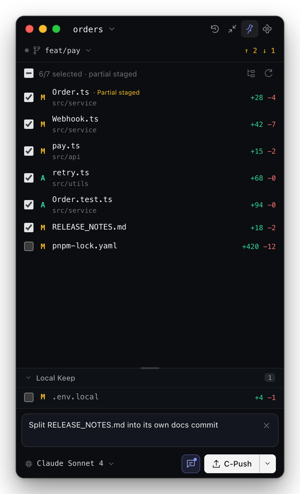
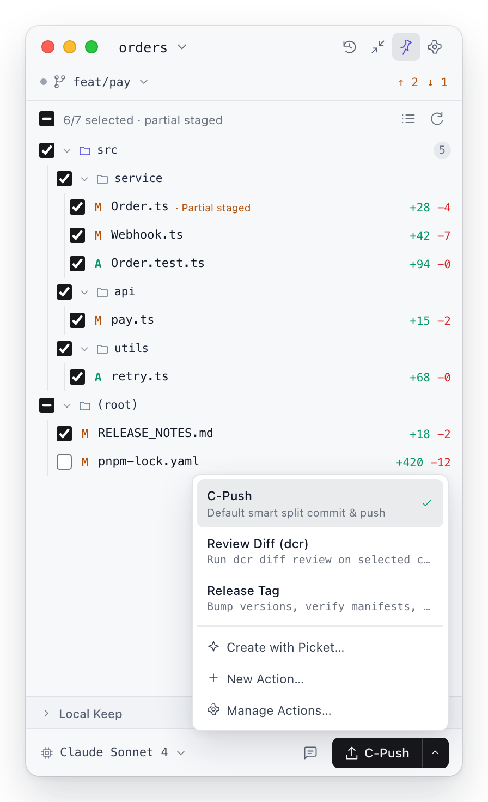

<p align="center">
  
</p>

<h1 align="center">Picket</h1>

<p align="center">
  <strong>A macOS desktop Git Agent &amp; lightweight local service runner that sits quietly beside your IDE.</strong>
</p>

<p align="center">
  <strong>English</strong> · <a href="README.zh-CN.md">简体中文</a>
</p>

<p align="center">
  macOS 14+ (Apple Silicon) · MIT License · English &amp; 简体中文 · System / Dark / Light Themes
</p>

---

**Picket** handles the noisy last mile of daily Git and local development without taking over your editor. Pick the exact files you want to ship and click **C-Push** — an isolated **Pi Core** agent inspects only your authorized diff, splits cohesive changes into clean Conventional Commits, commits strictly within scope, and pushes to your remote.

It pauses only when a real decision is needed, keeping unselected files, **Local Keep** paths, and unstaged IDE drafts byte-for-byte intact. Beyond committing, switch to repository-bound **Custom Actions** (`dcr` review, multi-stage `submit`, PR review, release tagging) or flip to the built-in **Run** tab to manage local dev servers and microservices in the background.

<table>
  <tr>
    <td align="center" width="50%">
      <br />
      <sub><strong>Main Workbench</strong> · Exact-scope selection, Local Keep &amp; one-click C-Push</sub>
    </td>
    <td align="center" width="50%">
      <br />
      <sub><strong>Unified Message Sheet</strong> · Structured findings, IDE jump &amp; in-place follow-up</sub>
    </td>
  </tr>
</table>

## What Picket Does

### Exact-Scope C-Push & Git Safety
- **One-click C-Push**: Analyzes authorized diffs on demand, splits changes into Conventional Commits, writes concise commit messages, and pushes (or commits locally when you add a quick note in the on-demand prompt box).
- **Zero index pollution**: Checking files in Picket never mutates `.git/index`. Partially staged files commit only their staged hunks by default, leaving unstaged IDE drafts and unselected staged files untouched.
- **Local Keep**: Drag or right-click local-only edits into the **Local Keep** group to exclude them from **Select All**, **C-Push**, and **Custom Actions** across all worktrees of a repository — without modifying `.gitignore`, `.git/info/exclude`, `skip-worktree`, or `assume-unchanged`.
- **Clean workspace views & safe sync**: Toggle between **List View** and **Directory Tree View**, switch local/remote branches or linked worktrees from an IDEA-style menu (with live external sync), run lossless **Pull & Rebase**, **Retry Push** without re-committing, and resolve rebase conflicts with explicit Agent authorization or IDE handoff.

### Unified Action Engine, Custom Actions & Skills
- **One session engine & interactive Message Sheet**: **C-Push**, **Custom Actions**, and **Pull & Rebase** share a unified session protocol, zero-token host recovery handoff, and floating **Message Sheet** (`MessageDock`) with 7 native theme-adaptive UI blocks (Markdown, callouts, facts, IDE-clickable findings, checklists, collapsible code wells, file chips) and in-place follow-up steering.
- **Custom Actions & cross-repo sync**: Switch the Split Button (Full & Compact) to per-repository actions — usable even on a clean working tree. Author actions manually or chat with Picket in natural language, then selectively sync them across registered repositories on save.
- **3-mode Action Approval**: Configure global write-command confirmation behavior in **Settings → General** (**`Ask`** · **`Auto`** · **`Always Allow`**). Decision questions still pause when your input is needed, and hard safety redlines (no force-push, no destructive resets) remain permanently enforced.
- **Guarded tools & Git Skills**: Reuses your local `gh` / `glab` login with isolated `submit` worktrees and cold-restart session restoration. Ships with 8 offline Git skills (`commit`, `push`, `cpush`, `dcr`, `create-issues`, `create-pr`, `review-pr`, `submit`) that can be toggled or hot-synced from custom repositories in **Settings → Skills**.

<table>
  <tr>
    <td align="center" valign="middle" width="52%">
      <br />
      <sub><strong>Light Theme &amp; Custom Actions</strong> · Directory tree view &amp; Split Button switcher</sub>
    </td>
    <td align="center" valign="middle" width="48%">
      <br />
      <sub><strong>Menu Bar Residency</strong> · Running services &amp; prioritized multi-repo status popover</sub>
    </td>
  </tr>
</table>

### Local Run Services & Independent Run Logs
- **`Git | Run` dual view (zero LLM at runtime)**: Manage long-running dev servers, backend APIs, microservices, and project scripts per repository (up to 64 commands) completely independent of Git write locks, with 12 built-in SVG runtime icons, live output previews, and clickable port chips.
- **Multi-module AI Project Scan**: Read-only scan across single-package and multi-module workspaces (Maven / Spring Cloud, Gradle, pnpm/npm/yarn workspaces, Cargo, Go `go.work`, `Makefile`, `scripts/`). Large repos automatically gain a **Running Now** pin bar, collapsible groups, and instant search — or add commands manually offline.
- **Native user shell & clean process-group teardown**: Runs with your login shell environment (`$SHELL` — `nvm`, `fnm`, `volta`, `mise`, `pyenv`, `cargo`, Homebrew) without exposing Picket API keys. Supports repo-level **Shared Env** (setting `JAVA_HOME` automatically prepends `<JAVA_HOME>/bin` to `PATH`) plus per-command overrides. Each service runs in its own Unix process group (`PGID`) for clean full-tree stop, startup cancellation, and quit protection.
- **Independent pop-out Run Logs window**: Open a reusable, tabbed native **Run Logs** window with UTF-8-safe bounded streaming logs, clickable `localhost` links, and clear/stop controls. Closing windows leaves running services alive in the background, controllable from the menu bar popover.

### Pinned Compact Mode & Native macOS Integration
- **Compact Mode & instant double-click toggle**: Double-click the blank top bar of the main window (or click the toolbar toggle) to smoothly switch between **Full Mode** (`400 × 700`) and **Compact Mode** (`400 × ~86` floating 2-row bar with quick drawers for projects, branches, remote sync, files, actions, and Run services). Pin independently to stay on top across macOS Desktop Spaces.
- **Menu bar background residency**: Closing the main window quietly hides Picket to the top menu bar without keeping a Dock icon while active sessions and local Run services keep running. The menu bar popover surfaces live running services (jump to logs or one-click Stop) and prioritized repo status, folding clean idle repos when more than five are open.
- **Adaptive themes, external IDEs & quiet updates**: Instant **English / 简体中文** switching, **System / Dark / Light** themes across the animated launch whale splash, workbench, tray popover, and Run Logs window, auto-detected IDE integration, unfocused-only macOS notifications, and Ed25519-signed in-app updates (**Settings → About & Updates**).

<table>
  <tr>
    <td align="center" valign="middle" width="50%">
      <br />
      <sub><strong>Pinned Compact Mode</strong> · Floating 2-row bar (<code>400 × ~86</code>) with Split Button</sub>
    </td>
    <td align="center" valign="middle" width="50%">
      <br />
      <sub><strong>Quick Drawer</strong> · Toggle files, switch branches/actions, run services, or pull &amp; rebase</sub>
    </td>
  </tr>
</table>

## Typical Workflow

1. **Open a repository**: Launch Picket and add any local Git repository (linked worktrees and external changes stay in sync automatically).
2. **Confirm scope**: Normal changes are selected by default; uncheck unfinished files, switch to **Tree View**, or drag local-only edits into **Local Keep**. Double-click any row to inspect diffs in your IDE.
3. **Guide or switch (optional)**: Click the compact prompt icon beside **C-Push** for one-off instructions (e.g. *"commit locally without pushing"*), switch the Split Button to a Custom Action, or flip to **Run** to start local services.
4. **Ship in one click**: Click **C-Push** (or your active Custom Action). Picket handles splitting, committing, syncing, and pushing — notifying you only when a decision, conflict, or push retry needs attention.

## Supported Providers & Editors

### Model Providers

Configure each provider connection once (base URL & API key), then fetch or add as many child models under it as you need.

| Provider | Default API Format | Notes |
| --- | --- | --- |
| **Anthropic** | Anthropic Messages (`/v1/messages`) | API key isolated in `~/.picket/credentials.json` (`0600`) |
| **OpenAI** | OpenAI Responses (`/responses`) | Also supports Chat Completions |
| **DeepSeek** | OpenAI Chat Completions (`/chat/completions`) | API key isolated in `~/.picket/credentials.json` (`0600`) |
| **Ollama (Local)** | OpenAI Chat Completions (`/chat/completions`) | Connects locally (e.g. `http://127.0.0.1:11434/v1`), no API key required |
| **Custom Compatible** | Configurable | Supports OpenAI Chat Completions, OpenAI Responses, and Anthropic Messages |

### External IDEs

Auto-detected on macOS with per-project preference: **IntelliJ IDEA**, **RustRover**, **WebStorm**, **Visual Studio Code**, and **Cursor**.

## Security & Privacy

- **Isolated `~/.picket/` storage**: All local persistence uses `0700` directory and `0600` atomic files. API keys are stored exclusively in `~/.picket/credentials.json` keyed by connection ID — never written to `models.json`, session history, logs, or frontend state.
- **Authenticated key reveal**: Viewing a saved full API key requires macOS device authentication (**Touch ID** or login password) and clears from memory after 30 seconds or on window blur.
- **Zero hidden credentials**: Starts with zero repositories and zero models; never reads shell API keys or external developer logins into the AI runtime.
- **Rust-controlled execution**: Every Git write, file edit, and local verification command is validated and executed by the native Rust layer — models never run unrestricted shell commands against your repo.
- **Local auth reuse**: Push, fetch, and `gh` / `glab` operations reuse your existing local Git/CLI authentication with no extra account sign-in.

## Getting Started

> **Platform**: **macOS 14.0+ on Apple Silicon (`arm64`)**. Prebuilt `.dmg` test releases are available on [GitHub Releases](https://github.com/dpbs-715/Picket/releases) (ad-hoc signed; after dragging to Applications, run `xattr -dr com.apple.quarantine /Applications/Picket.app`), or build from source below.

### Prerequisites (From Source)

- macOS 14.0+ on Apple Silicon (`arm64`) & Xcode Command Line Tools (`xcode-select --install`)
- [Node.js](https://nodejs.org/) `24.17.0` and [pnpm](https://pnpm.io/) `10.28.1`
- [Rust](https://rustup.rs/) `1.100.0` via `rustup` (pinned in [rust-toolchain.toml](rust-toolchain.toml))

### Run or Build Locally

```bash
git clone https://github.com/dpbs-715/Picket.git
cd Picket
pnpm install --frozen-lockfile

# Run in desktop development mode
pnpm desktop dev

# Build the standalone macOS .app bundle
pnpm desktop build
```

The built bundle is output to `src-tauri/target/release/bundle/macos/Picket.app`.

## Architecture & Development

Built with **Tauri 2 (Rust)**, **React 19 + TypeScript**, and an isolated **Pi Core** sidecar process:

- `src/` — React workbench UI, Compact Mode, Tray Popover, independent Run Logs window, and `src/desktop/` typed IPC wrappers.
- `shared/` — Shared IPC protocols and Rust-generated TypeScript contracts (`shared/generated/`, synced via `pnpm protocol:sync`).
- `agent/` — Bundled Pi Core sidecar runtime, execution profiles, tool loop guards, and built-in Git skills.
- `src-tauri/` — Native Rust coordinator for Git reads/writes, unified Action sessions, local Run process groups, window motion, menu bar tray, credentials, and signed updates.

Key verification commands (see [AGENTS.md](AGENTS.md) for full guidelines and invariants):

```bash
pnpm check                  # Protocol sync check, TypeScript typecheck, Vitest, Rust fmt/clippy & tests
pnpm ui:verify              # Headless Chrome UI interaction & layout regression suite
pnpm package:verify --ui    # End-to-end verification against the packaged macOS .app bundle
```

## License

Released under the [MIT License](LICENSE).
