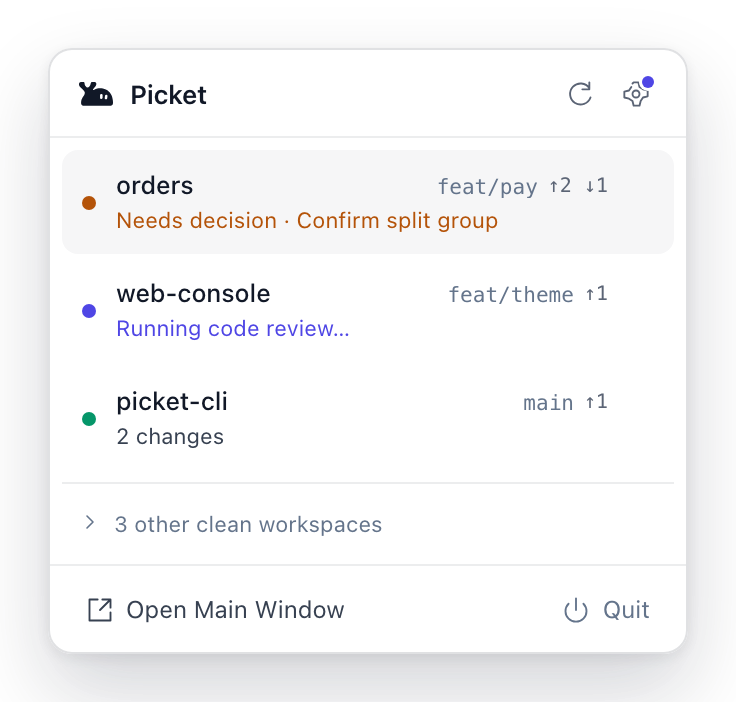
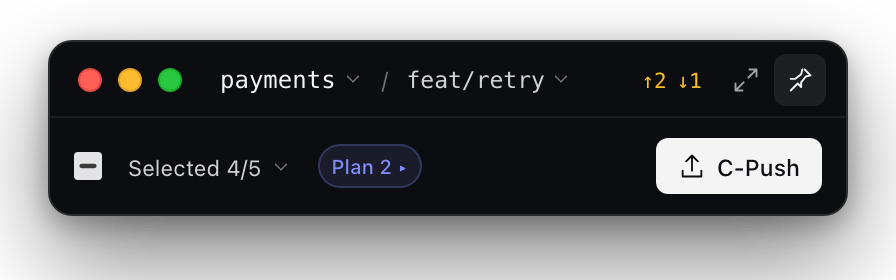

<p align="center">
  
</p>

<h1 align="center">Picket</h1>

<p align="center">
  <strong>A macOS desktop Git Agent for exact-scope committing, pushing, and running custom Git workflows in one click.</strong>
</p>

<p align="center">
  <strong>English</strong> · <a href="README.zh-CN.md">简体中文</a>
</p>

<p align="center">
  macOS 14+ (Apple Silicon) · MIT License · English &amp; 简体中文 · System / Dark / Light Themes
</p>

---

**Picket** sits quietly beside your IDE and handles the noisy last mile of Git. Pick the files you want to ship and click **C-Push** — Picket inspects your authorized diff via an isolated **Pi Core** agent loop, groups related changes into clean Conventional Commits, writes clear commit messages, commits strictly within your selected scope, and pushes to your remote (or commits locally when asked).

It pauses to ask only when a real decision is needed, leaving unselected files, **Local Keep** paths, and unstaged IDE drafts byte-for-byte untouched. When you need richer workflows — such as `dcr` diff review, multi-stage `submit`, PR review, or release tagging — switch the footer Split Button to a repository-bound **Custom Action** and interact through Picket's unified **Message Sheet**.

<table>
  <tr>
    <td align="center" width="50%">
      <br />
      <sub><strong>Main Workbench</strong> · Exact-scope selection, Local Keep &amp; one-click C-Push</sub>
    </td>
    <td align="center" width="50%">
      <br />
      <sub><strong>Unified Message Sheet</strong> · Structured findings, IDE jump &amp; in-place follow-up</sub>
    </td>
  </tr>
</table>

## Highlights

### One-Click C-Push & Distraction-Free Workbench
- **Smart split, commit & push**: Select your changes and click **C-Push**. Picket's Pi Core agent loop inspects scoped diffs on demand, groups cohesive changes into Conventional Commits, commits each group strictly within scope, and pushes to the remote branch — or stops after local commits when you pass instructions like *"commit locally without pushing"*.
- **Ask only when it matters**: No confirmation popups on every commit. Picket pauses only for genuine ambiguity (such as unclear file ownership, sensitive files, or a missing upstream target).
- **Full-height file list, Tree View & zero-footprint prompt**: Switch cleanly between **List View** and **Directory Tree View** (with folder tri-state checkboxes and guide lines). When idle, the changes list fills the entire workspace; click the compact prompt icon beside **C-Push** to slide open a sleek rounded prompt box for extra guidance.

### Exact-Scope Git Safety & Local Keep
- **Selection never mutates `.git/index`**: Checking or unchecking files in Picket controls active scope only — it never runs `git add` or `git reset` behind your back.
- **Partial staging preserved**: When a file has both staged and unstaged edits, Picket commits only the staged hunks by default and leaves your unstaged IDE drafts byte-for-byte intact.
- **Zero leakage from unselected staged files**: Files staged in Git but unchecked in Picket are never swept into a commit.
- **Local Keep**: Drag files (or right-click single or multi-selected rows) into the bottom **Local Keep** group to exclude local-only edits from **Select All**, **C-Push**, and **Custom Actions** across every worktree of that repository — without touching `.gitignore`, `.git/info/exclude`, `skip-worktree`, or `assume-unchanged`.

### Unified Interactive Message Sheet (`message_user`)
- **Rich structured communication**: Powered by Pi Core's unified `message_user` tool, Picket renders progress updates, `dcr` code reviews, release checklists, command previews, and blocking decision prompts inside a tactile macOS floating sheet (`MessageDock`).
- **Seven adaptive native UI blocks**: Supports safe Markdown, callouts, recessed key-value facts grids, severity-tagged findings (click any finding or file chip to jump straight to `path:line` in your IDE, even on a clean working tree), status checklists, collapsible copyable code wells, and file chips — styled cleanly for both Dark and Light themes with zero raw HTML injection.
- **Built for reading & follow-up**: Drag the top grab handle smoothly to resize (drag to top to snap full-height, double-click to reset), keep the live progress bar pinned beneath the header while command logs scroll independently, steer or continue settled custom actions in place with follow-up messages, and dismiss finished cards from the header `×` button.

### Custom Repository Actions & Hot-Synced Git Skills
- **Split Button action switcher (Full & Compact)**: Keep **C-Push** as the default primary button, or switch via the Split Button menu (and Compact Mode drawer) to per-repository Custom Actions — such as `dcr` diff review, multi-stage `submit`, PR reviews, or release tagging — usable even on a clean working tree.
- **Create with Picket & selective cross-repo sync**: Define actions manually or chat with Picket in natural language to inspect branches, tags, remotes, and release scripts and draft a ready-to-save action. When saving, pick exactly which registered repositories to sync to via a tri-state **Select All** checklist with live status badges (`Synced`, `Will update`, `Same name`, `Full`) — syncing atomically on **Save & Sync**.
- **Guarded workspace tools, `gh` / `glab` & isolated `submit` recovery**: Custom actions can edit or create authorized files (`edit_repo_file`, `write_repo_file`), run discrete local checks (`run_repo_command`, zero shell interpolation), and commit strictly tracked paths (`commit_exact_scope`) while leaving unselected drafts and `Local Keep` untouched. Reuses your existing local `gh` / `glab` login with hard safety redlines, Tier-2 command previews (with prompt-hash-bound "Don't ask again"), isolated `submit` worktrees with verified backup cleanup, and cold-restart session restoration.
- **Built-in & hot-synced skills (`Settings → Skills`)**: Eight Git collaboration skills (`commit`, `push`, `cpush`, `dcr`, `create-issues`, `create-pr`, `review-pr`, `submit`) ship bundled offline. Sync updates or custom `SKILL.md` repositories on demand into `~/.picket/skills/`, toggle individual skills on or off, or restore the bundled snapshot in one click without disrupting active tasks.

<table>
  <tr>
    <td align="center" valign="middle" width="52%">
      <br />
      <sub><strong>Light Theme &amp; Custom Actions</strong> · Directory tree view &amp; Split Button switcher</sub>
    </td>
    <td align="center" valign="middle" width="48%">
      <br />
      <sub><strong>Menu Bar Residency</strong> · Prioritized multi-repo status popover without Dock clutter</sub>
    </td>
  </tr>
</table>

### Branches, Live Worktrees, Sync & Controlled Recovery
- **IDEA-style branch menu & live worktree sync**: Switch local branches, check out remote tracking branches, or jump directly to linked worktrees from one compact menu. External worktree additions/removals, branch switches, and working-tree edits reconcile automatically without manual refreshes. `main` and `master` display a lightweight **Protected** badge inside the menu while allowing direct pushes; detached `HEAD` prompts you to switch to a local branch first.
- **Lossless Pull & Rebase**: Pull and rebase remote updates while preserving non-overlapping staged and unstaged changes — without risky auto-stashing.
- **Retry Push only**: If local commits succeed but pushing fails, your commits and prompt stay intact; clicking **Retry Push** pushes existing commits without re-creating them.
- **Controlled conflict handling**: If a rebase hits a conflict, you can explicitly authorize the Agent to merge only the active conflicted files (validated for conflict markers and path boundaries) or resolve them in your IDE and return to Picket for automatic reconciliation.
- **Safe by default**: Picket never auto-force-pushes, discards uncommitted work, or silently rewrites published remote history.

### Lightweight Local Run Commands & Pop-Out Logs
- **Direct user-shell execution, zero LLM at runtime**: Switch cleanly between **Git** and **Run** views in the workbench header (or use the Compact Mode quick-run controls) to launch, restart, and stop long-running local services (such as frontend dev servers, backend APIs, microservices, or `pnpm desktop dev --no-watch`) with 12 built-in SVG runtime icons, live output previews, and clickable port chips — persisted per repository (up to 64 commands) with zero commands by default and completely independent of Git write locks.
- **Strict user environment, shared repo env & clean process-group teardown**: Loads your own login shell environment (`$SHELL`, e.g. `nvm`, `fnm`, `volta`, `mise`, `pyenv`, `cargo`, Homebrew) without falling back to Picket's bundled `picket-node` or exposing Picket API keys. Configure repository-level **Shared Env** (e.g. `JAVA_HOME`, `SPRING_PROFILES_ACTIVE`, `MAVEN_OPTS` — setting `JAVA_HOME` automatically prepends `<JAVA_HOME>/bin` to `PATH`) while individual command env vars override shared values. Each service runs in its own Unix process group (`PGID`), so stopping, restarting, or quitting terminates the full child process tree cleanly.
- **Multi-module AI project scan & grouped service list**: Click **AI Scan Project** to recursively inspect single-module and multi-module workspaces read-only (Maven / Spring Cloud nested parent POMs & `@SpringBootApplication` starters, Gradle multi-project, pnpm/npm/yarn workspaces, Cargo workspaces, Go `go.work`, `Makefile`, `scripts/`). Large or grouped repositories automatically organize commands into collapsible groups (such as `Maven` root install + `Spring Boot` microservices), pin active services into **Running Now**, and add an instant quick-filter bar — or add and group commands manually offline.
- **Pop-out Run Logs window, background residency & quit guard**: Open a reusable tabbed **Run Logs** window on demand with live streaming output, clickable validated `localhost` URLs, and clear/restart/stop controls. Closing the main window or log window leaves running services alive in the background (with live service visibility, log jump, and one-click Stop in the menu bar popover); quitting Picket prompts before cleanly stopping all running process groups.

### Pinned Compact Mode, Themes & macOS Integration
- **Designed to stay beside your IDE**: Toggle **Compact Mode** (`400 × ~86` floating 2-row bar with quick drawers for projects, branches, remote pull & rebase, file selection, local Run commands, and custom actions), **Always-on-Top Pin** (follows you across macOS Desktop Spaces), and **Settings** independently from the permanent top-right toolbar.
- **macOS menu bar background residency**: Closing the main window quietly hides Picket to the top menu bar and hides its Dock icon while keeping active tasks, running local services, and unsent prompts alive. Clicking the menu bar whale opens a compact status popover without popping the Dock — surfacing running services (with direct **Stop** and log-window jump), urgent and dirty repositories first, folding clean idle workspaces when more than five are open, and offering direct **Open Main Window** and **Quit** controls.
- **Adaptive themes & animated launch splash**: Instant **English** / **简体中文** UI switching and **System / Dark / Light** appearance modes that synchronize the animated cold-launch whale splash (Pearl Whale in Dark mode, Slate Marine in Light mode), main workbench, compact bar, tray popover, and native macOS window chrome — alongside per-project **Preferred Editor** and **Commit Message Language** settings.
- **Unobtrusive notifications & external IDE handoff**: Native macOS notifications fire only when Picket is unfocused and your input is needed. Auto-detects installed editors (`IntelliJ IDEA`, `RustRover`, `WebStorm`, `VS Code`, `Cursor`) to open files, diffs, staged diffs, review lines, and conflict merges.
- **Quiet in-app updates**: Single-channel signed update checks in **Settings → About & Updates** with a subtle indicator dot, download progress, Ed25519 signature verification, active-Git-task safety guards, and clean restart (plus direct GitHub Releases fallback).

<table>
  <tr>
    <td align="center" valign="middle" width="50%">
      <br />
      <sub><strong>Pinned Compact Mode</strong> · Floating 2-row bar (<code>400 × ~86</code>) with Split Button</sub>
    </td>
    <td align="center" valign="middle" width="50%">
      <br />
      <sub><strong>Quick Drawer</strong> · Toggle files, switch branches/actions, or pull &amp; rebase inline</sub>
    </td>
  </tr>
</table>

## Typical Workflow

1. **Open a local repository**: Launch Picket and open any local Git repository (linked worktrees and external Git changes stay in sync automatically).
2. **Pick your scope**: Normal changes are selected by default; uncheck anything not ready yet, toggle **Tree View** to group by folder, or drag local-only files into **Local Keep**. Double-click any file or click **Diff** to inspect it in your IDE.
3. **Add brief guidance or switch actions (optional)**: Click the footer prompt icon beside **C-Push** to add one-off instructions (such as *"commit locally only"*), or switch the Split Button to a Custom Action (`dcr` review, `submit`, PR review, or `Release Tag`).
4. **Ship in one click**: Click **C-Push** (or your active Custom Action). Picket handles splitting, committing, syncing, and pushing — notifying you only when a decision, conflict, or push retry needs your attention.

## Supported Providers & Editors

### Model Providers

Configure each provider connection once (base URL & API key), then add as many models under that connection as you need (including live remote model list fetching). Picket connects through an isolated bundled Pi Core runtime.

| Provider | Default API Format | Notes |
| --- | --- | --- |
| **Anthropic** | Anthropic Messages (`/v1/messages`) | API key stored in `~/.picket/credentials.json` (`0600`) |
| **OpenAI** | OpenAI Responses (`/responses`) | Also supports Chat Completions |
| **DeepSeek** | OpenAI Chat Completions (`/chat/completions`) | API key stored in `~/.picket/credentials.json` (`0600`) |
| **Ollama (Local)** | OpenAI Chat Completions (`/chat/completions`) | Connects to local server (e.g. `http://127.0.0.1:11434/v1`), no API key required |
| **Custom Compatible** | Configurable | Supports OpenAI Chat Completions, OpenAI Responses, and Anthropic Messages |

### External IDEs

Picket automatically detects installed IDEs on macOS and lets you pick a preferred editor per project:

- **IntelliJ IDEA**
- **RustRover**
- **WebStorm**
- **Visual Studio Code**
- **Cursor**

## Security & Privacy

- **Isolated local data & credentials (`~/.picket/`)**: All Picket state lives under `~/.picket/` (`0700` directory, `0600` files). API keys are isolated in `~/.picket/credentials.json` (`0600`) keyed by provider connection — never written to `models.json`, `workbench-state.json`, session history, logs, or frontend state.
- **Configure a provider once, add models on demand**: Child models inherit their parent connection's endpoint and API key automatically; rotating a connection key updates every model under that connection at once. Revealing a saved full key in **Edit Connection** requires macOS device authentication (**Touch ID** or login password) and automatically clears from memory after 30 seconds or when the window loses focus.
- **Zero hidden credentials**: Picket starts with zero repositories and zero models; it never reads shell environment keys or external developer logins.
- **Controlled local execution**: All Git writes, file edits, and local verification commands are validated and executed by the native Rust desktop layer — models never run unrestricted shell commands against your repository.
- **Uses your existing Git auth**: Remote push, fetch, and `gh` / `glab` operations reuse your existing local credentials with no extra account login required.

## Getting Started

> **Platform note**: Picket supports **macOS 14.0+ on Apple Silicon (`arm64`)**. Internal test `.dmg` builds are published on [GitHub Releases](https://github.com/dpbs-715/Picket/releases) (ad-hoc signed; run `xattr -dr com.apple.quarantine /Applications/Picket.app` after dragging to Applications), or you can build locally from source below.

### Prerequisites (Building from Source)

- macOS 14.0 or later on Apple Silicon (`arm64`)
- Xcode Command Line Tools (`xcode-select --install`)
- [Node.js](https://nodejs.org/) `24.17.0`
- [pnpm](https://pnpm.io/) `10.28.1`
- [Rust](https://rustup.rs/) via `rustup` (toolchain pinned in [rust-toolchain.toml](rust-toolchain.toml))

### Run or Build from Source

```bash
git clone https://github.com/dpbs-715/Picket.git
cd Picket
pnpm install --frozen-lockfile

# Run in desktop development mode
pnpm desktop dev

# Or build the standalone macOS .app bundle
pnpm desktop build
```

The packaged application is written to `src-tauri/target/release/bundle/macos/Picket.app`.

### First Launch

1. Click **Open Local Repository…** to add a Git working directory.
2. Click **Configure Model** (or open **Settings**) to add your preferred model provider, fetch or select a model, and test the connection.
3. Review your selected files and click **C-Push**.

## Development & Contributing

Built with **Tauri 2 (Rust)**, **React + TypeScript**, and an isolated **Pi Core** sidecar process (`src/` modular workbench hooks & UI, `shared/` typed IPC protocols, `agent/` Pi Core runtime & skills, `src-tauri/` Rust Git/action/window/tray/updater domains).

- Read [AGENTS.md](AGENTS.md) for architecture details, invariants, verification scripts, and coding guidelines.
- Run `pnpm check` for TypeScript checks, Node tests, Rust formatting/Clippy, and Rust tests, and `pnpm ui:verify` for headless Chrome UI regression checks.

## License

Released under the [MIT License](LICENSE).
