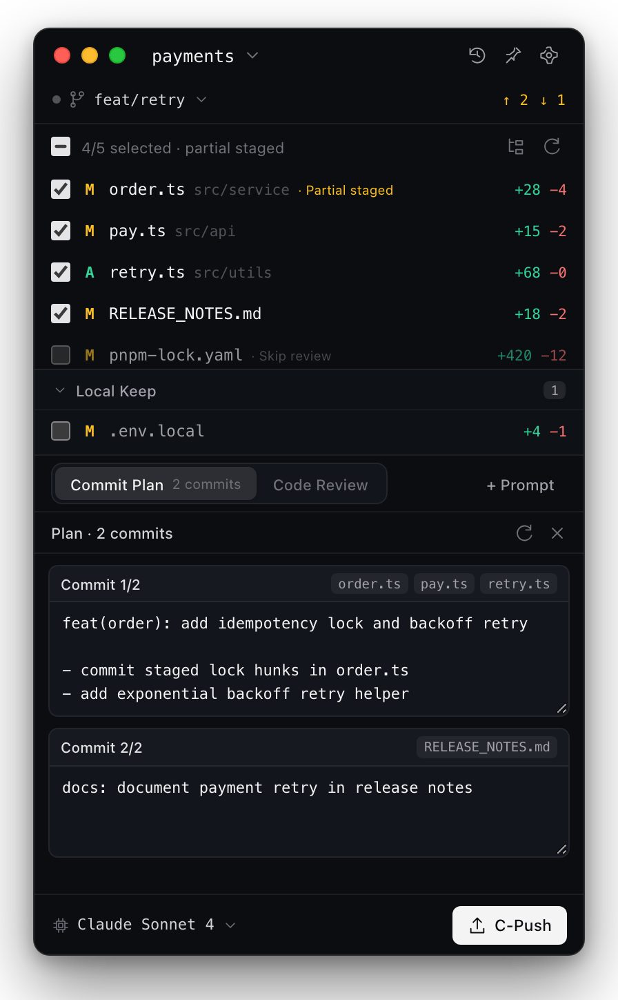
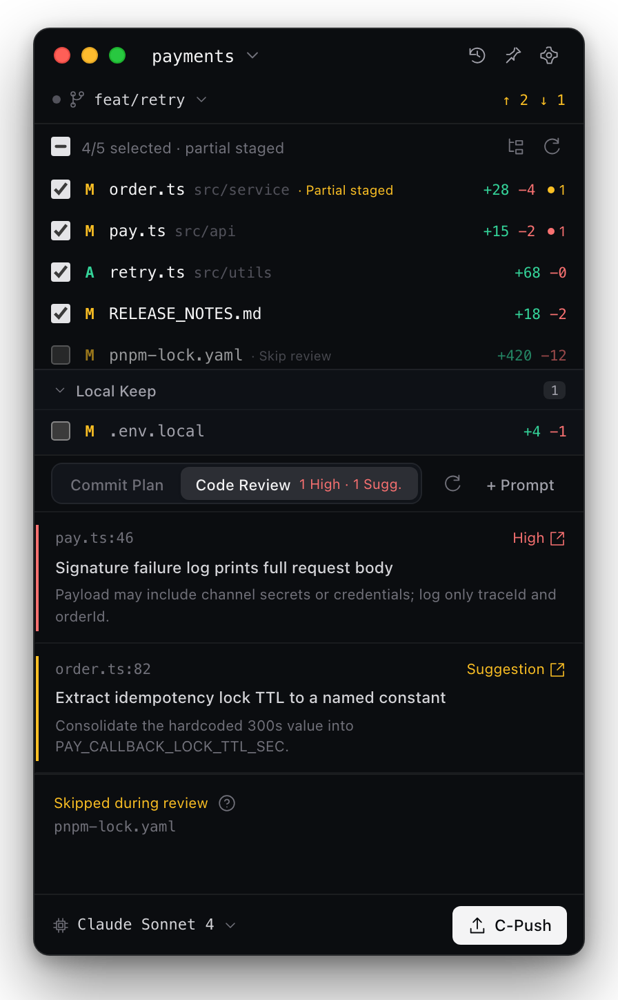

<p align="center">
  
</p>

<h1 align="center">Picket</h1>

<p align="center">
  <strong>A macOS desktop Git Agent for scoping, splitting, committing, pushing, and running custom Git workflows in one click.</strong>
</p>

<p align="center">
  <strong>English</strong> · <a href="README.zh-CN.md">简体中文</a>
</p>

<p align="center">
  macOS 14+ (Apple Silicon) · MIT License · English &amp; 简体中文 UI
</p>

---

**Picket** sits quietly beside your IDE and handles the noisy last mile of Git. Instead of manually untangling mixed edits, writing repetitive commit messages, or risking half-finished drafts, you pick the files you want to ship and click **C-Push** — Picket splits related changes into clean commits, writes messages, commits strictly within your selected scope, and pushes to your remote.

It pauses to ask only when a real decision is needed, leaving unselected files, **Local Keep** paths, and unstaged IDE drafts completely untouched. When you need deeper workflows — such as `dcr` diff review, multi-stage `submit`, PR review, or release tagging — switch the primary action to a repository-bound Custom Action and interact through Picket's unified **Message Sheet**.

<table>
  <tr>
    <td align="center" width="50%">
      <br />
      <sub><strong>Main Workbench</strong> · Exact-scope selection, Local Keep &amp; one-click C-Push</sub>
    </td>
    <td align="center" width="50%">
      <br />
      <sub><strong>Structured Feedback</strong> · Actionable findings with one-click IDE jump</sub>
    </td>
  </tr>
</table>

## Highlights

### One-Click C-Push & Distraction-Free Workbench
- **Smart split, commit & push**: Select your changes and click **C-Push**. Picket analyzes your authorized diff, groups related files into Conventional Commits, commits each group cleanly, and pushes to the remote branch.
- **Ask only when it matters**: No confirmation popups on every commit. Picket pauses only for genuine ambiguity (such as unclear file ownership, sensitive files, or a missing upstream target).
- **Full-height file list & zero-footprint prompt**: When idle, the changes list expands all the way to the footer with no empty strip above it. Click the compact prompt icon beside **C-Push** whenever you want to slide open a sleek input box for extra guidance (like *"split lockfile separately"* or *"commit locally without pushing"*); when a Custom Action is active, a one-line summary pill appears above the footer to preview or edit its instructions.

### Exact-Scope Git Safety & Local Keep
- **Selection never mutates `.git/index`**: Checking or unchecking files in Picket only controls the active scope — it never runs `git add` or `git reset` behind your back.
- **Partial staging preserved**: When a file has both staged and unstaged edits, Picket commits only the staged hunks by default and leaves your unstaged IDE drafts byte-for-byte intact.
- **Zero leakage from unselected staged files**: Files staged in Git but unchecked in Picket are never swept into a commit.
- **Local Keep**: Drag files (or right-click single or multi-selected rows) into the bottom **Local Keep** group to keep local-only edits out of **Select All** and **C-Push** across every worktree of that repository — without touching `.gitignore`, `.git/info/exclude`, `skip-worktree`, or `assume-unchanged`.

### Unified Interactive Message Sheet (`message_user`)
- **Rich structured communication**: Powered by Pi Core's unified `message_user` tool, Picket presents progress updates, structured reviews (`dcr`), release checklists, command previews, and blocking decision prompts in a tactile macOS floating sheet (`MessageDock`).
- **Seven native dark-mode blocks**: Supports safe Markdown, callouts, recessed key-value facts bars, severity-tagged findings (click any finding or file chip to jump straight to `path:line` in your IDE, even on a clean working tree), status checklists, collapsible copyable code wells, and file chips — with zero raw HTML injection.
- **Built for reading & follow-up**: Drag the top handle up or down to resize the sheet smoothly (drag to the top edge to snap full-height, double-click to reset), keep the live progress bar pinned while command logs scroll independently, send follow-up instructions in place after a custom action settles, and dismiss completed cards cleanly from the header `×` button.

### Custom Repository Actions & Hot-Synced Git Skills
- **Main action switcher (Full & Compact)**: Keep `C-Push` as the default primary button, or switch via the Split Button menu (and Compact Mode drawer) to per-repository custom actions — such as `dcr` diff review, multi-stage `submit` flows, PR reviews, or release tagging — usable even on a clean working tree.
- **Create with Picket & sync across repos**: Define actions manually or chat with Picket in natural language to inspect branches, tags, and remotes and draft a ready-to-save action. Copy any action to all registered repositories as independent editable copies in one click.
- **Controlled `gh` / `glab` & isolated `submit` recovery**: Reuse your existing local `gh` / `glab` authentication without extra tokens, enforce hard safety redlines and Tier-2 command previews (with prompt-hash-bound "Don't ask again"), isolate `submit` commits in managed worktrees with verified backup cleanup, and restore interrupted sessions (including rich report cards and Issue/PR links) across cold restarts.
- **Built-in & hot-synced skills (`Settings → Skills`)**: Eight Git collaboration skills (`commit`, `push`, `cpush`, `dcr`, `create-issues`, `create-pr`, `review-pr`, `submit`) ship bundled offline. Sync updates or custom `SKILL.md` repositories on demand via controlled shallow `/usr/bin/git` clones into `~/.picket/skills/`, toggle individual skills on or off, or restore the built-in snapshot in one click without disrupting running tasks.

### Branches, Worktrees, Sync & Controlled Recovery
- **IDEA-style branch menu**: Switch local branches, check out remote tracking branches, or jump directly to linked worktrees from one compact menu. `main` and `master` carry a lightweight **Protected** badge while allowing direct pushes; detached `HEAD` prompts you to switch to a local branch first.
- **Lossless Pull & Rebase**: Pull and rebase remote updates while preserving non-overlapping staged and unstaged changes — without risky auto-stashing.
- **Retry Push only**: If local commits succeed but pushing fails, your commits and prompt stay intact; clicking **Retry Push** pushes existing commits without re-creating them.
- **Controlled conflict handling**: If a rebase hits a conflict, you can explicitly authorize the Agent to merge the active conflicted files (validated for conflict markers and path boundaries) or open the conflict in your IDE and return to Picket for automatic reconciliation.
- **Safe by default**: Picket never auto-force-pushes, discards uncommitted work, or silently rewrites published remote history.

### Pinned Compact Mode & IDE-First Workflow
- **Designed to stay beside your IDE**: Toggle **Compact Mode** (`400 × ~86` floating 2-row bar with quick drawers for projects, branches, remote pull & rebase, and file selection), **Always-on-Top Pin** (follows you across macOS Desktop Spaces), and **Settings** independently at any time from the permanent top-right toolbar.
- **macOS menu bar background residency**: Closing the main window quietly hides Picket to the top menu bar and automatically hides its Dock icon (keeping active tasks and unsent prompts alive). Clicking the menu bar icon opens a compact read-only status popover without ever popping the Dock icon — sorting urgent/changed repositories to the top, auto-folding clean idle repositories when more than five are open, and offering direct **Open Main Window** and **Quit** controls.
- **Unobtrusive notifications**: When Picket is unfocused, native macOS notifications alert you only when your input is needed (decisions, conflicts, or push failures) without stealing focus or resizing the window.
- **Seamless external IDE integration**: Auto-detects installed editors (`IntelliJ IDEA`, `RustRover`, `WebStorm`, `VS Code`, `Cursor`) to open files, diffs, staged diffs, review lines, and conflict merges.
- **Bilingual & adaptive appearance**: Instant **English** / **简体中文** UI switching, **System / Dark / Light** theme modes (syncing the startup whale splash, main window, compact bar, tray popover, and native macOS window appearance), plus per-project **Preferred Editor** and **Commit Message Language** settings (Conventional Commit prefixes like `feat` and `fix` remain in English).
- **Quiet in-app updates**: Single-channel update checks via **Settings → About & Updates** with a subtle indicator dot when a newer signed release is available, live download progress, Ed25519 signature verification, active-Git-task safety guards, and graceful restart (plus direct GitHub Releases fallback).

<table>
  <tr>
    <td align="center" valign="middle" width="50%">
      <br />
      <sub><strong>Pinned Compact Mode</strong> · Floating 2-row bar (<code>400 × ~86</code>)</sub>
    </td>
    <td align="center" valign="middle" width="50%">
      <br />
      <sub><strong>Quick Drawer</strong> · Toggle files, switch branches, or pull &amp; rebase inline</sub>
    </td>
  </tr>
</table>

## Typical Workflow

1. **Open a local repository**: Launch Picket and open any local Git repository (linked worktrees are detected automatically).
2. **Pick your scope**: Normal changes are selected by default; uncheck anything not ready yet or drag local-only files into **Local Keep**. Double-click any file or click **Diff** to inspect it in your IDE.
3. **Add brief guidance or switch actions (optional)**: Click the footer prompt icon beside **C-Push** to pass extra instructions, or switch the footer primary button to a Custom Action (such as diff review with `dcr`, PR review, or `submit`).
4. **Ship with C-Push**: Click **C-Push**. Picket splits, commits, syncs if needed, and pushes — notifying you only if a decision, conflict, or push retry needs your attention.

## Supported Providers & Editors

### Model Providers

Configure each provider connection once (base URL & API key), then add as many models under that connection as you need. Picket connects through an isolated bundled Pi Core runtime.

| Provider | Default API Format | Notes |
| --- | --- | --- |
| **Anthropic** | Anthropic Messages (`/v1/messages`) | API key stored in `~/.picket/credentials.json` (`0600`) |
| **OpenAI** | OpenAI Responses (`/responses`) | Also supports Chat Completions |
| **DeepSeek** | OpenAI Chat Completions (`/chat/completions`) | API key stored in `~/.picket/credentials.json` (`0600`) |
| **Ollama (Local)** | OpenAI Chat Completions (`/chat/completions`) | Connects to local server (e.g. `http://127.0.0.1:11434/v1`), no API key required |
| **Custom Compatible** | Configurable | Supports OpenAI Chat Completions, OpenAI Responses, and Anthropic Messages |

### External IDEs

Picket automatically detects installed IDEs on macOS and lets you pick a preferred editor per project:

- **IntelliJ IDEA**
- **RustRover**
- **WebStorm**
- **Visual Studio Code**
- **Cursor**

## Security & Privacy

- **Isolated local data & credentials (`~/.picket/`)**: All Picket data lives under `~/.picket/` (`0700` directory, `0600` files). API keys are stored strictly in a dedicated `~/.picket/credentials.json` (`0600`) file keyed by provider connection — never written to `models.json`, `workbench-state.json`, session history, logs, or frontend state, and without repeated macOS Keychain prompts across ad-hoc test builds.
- **Configure a provider once, add models on demand**: Child models inherit their parent connection's endpoint and API key automatically without re-entering secrets; rotating a connection key updates every model under that connection at once. Viewing a saved full key in **Edit Connection** still requires macOS device authentication (**Touch ID** or login password) and automatically hides after 30 seconds or when the window loses focus.
- **Zero hidden credentials**: Picket starts with zero repositories and zero models; it never reads shell environment keys or external developer logins.
- **Controlled local Git execution**: All Git writes are verified and executed by the native Rust desktop layer — models never run arbitrary shell commands against your repository.
- **Uses your existing Git auth**: Remote push and fetch reuse your existing local Git / SSH credentials with no extra account login required.

## Getting Started

> **Platform note**: Picket currently supports **macOS 14.0+ on Apple Silicon (`arm64`)**. Pre-built signed `.dmg` releases are not published yet; build and run locally from source below.

### Prerequisites

- macOS 14.0 or later on Apple Silicon (`arm64`)
- Xcode Command Line Tools (`xcode-select --install`)
- [Node.js](https://nodejs.org/) `24.17.0`
- [pnpm](https://pnpm.io/) `10.28.1`
- [Rust](https://rustup.rs/) via `rustup` (toolchain pinned in [rust-toolchain.toml](rust-toolchain.toml))

### Run or Build from Source

```bash
git clone https://github.com/dpbs-715/Picket.git
cd Picket
pnpm install --frozen-lockfile

# Run in desktop development mode
pnpm desktop dev

# Or build the standalone macOS .app bundle
pnpm desktop build
```

The packaged application is written to `src-tauri/target/release/bundle/macos/Picket.app`.

### First Launch

1. Click **Open Local Repository…** to add a Git working directory.
2. Click **Configure Model** (or open **Settings**) to add your preferred model provider and test the connection.
3. Select the files you want to ship and click **C-Push**.

## Development & Contributing

Built with **Tauri 2 (Rust)**, **React + TypeScript**, and an isolated **Pi Core** sidecar process.

- Read [AGENTS.md](AGENTS.md) for architecture details, invariants, verification scripts, and coding guidelines.
- Run `pnpm check` to execute TypeScript checks, Node tests, Rust formatting/Clippy checks, and Rust integration tests.

## License

Released under the [MIT License](LICENSE).
