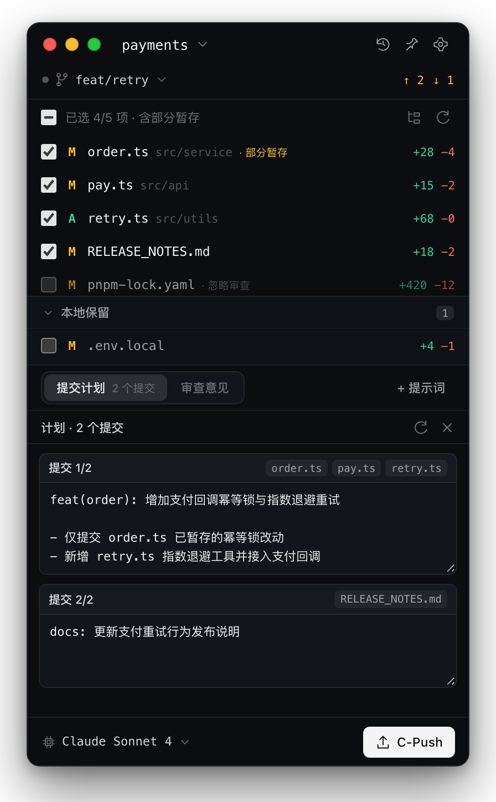

<p align="center">
  
</p>

<h1 align="center">Picket</h1>

<p align="center">
  <strong>面向 macOS 的桌面端 Git Agent：精确圈定变更范围、按需代码审查，一键完成拆分、提交与推送。</strong>
</p>

<p align="center">
  <a href="README.md">English</a> · <strong>简体中文</strong>
</p>

<p align="center">
  macOS 14+（Apple Silicon） · MIT 协议 · 中英双语界面
</p>

---

**Picket** 安静地停靠在你的 IDE 旁边，帮你接管 Git 提交与推送的“最后一公里”。写完代码后，不用手动拆拣混在一起的改动、反复斟酌提交说明，也不用担心误提交未完成的草稿——选定本次要发出的文件，按需发起代码审查或预览提交计划，点一下 **C-Push**，Picket 会自动按语义分组、生成规范的提交说明、严格按所选范围写入提交并推送到远端。

它只在真正需要你拍板时停下询问；未勾选的文件、**本地保留**文件以及 IDE 中尚未暂存的草稿始终原封不动。

<table>
  <tr>
    <td align="center" width="50%">
      <br />
      <sub><strong>主工作台</strong> · 精确范围勾选、本地保留与可编辑提交计划</sub>
    </td>
    <td align="center" width="50%">
      <br />
      <sub><strong>代码审查</strong> · 结构化风险提示，一键跳转 IDE 对应行号</sub>
    </td>
  </tr>
</table>

## 核心能力

### 一键 C-Push 与可编辑的预生成计划
- **自动拆分、提交与推送**：勾选要提交的文件后点击 **C-Push**，Picket 会分析已授权的改动范围，按 Conventional Commits 规范自动拆分为多个清晰的提交，依次写入本地并推送至远端分支。
- **只在必要时打断**：不为每次常规提交增加多余的确认弹窗；仅在归属不明确、涉及敏感文件或缺少远端跟踪目标等真正需要决定的场景暂停询问。
- **按需填写 `+ 提示词`**：可补充简短要求（例如“lock 文件单独提交”或“说明写得简洁一点”），同时指导提交规划与代码审查，且绝不会擅自扩大提交范围。
- **预生成计划（可逐条编辑）**：想先看方案再提交时，点击 **预生成计划** 即可直接编辑每组提交说明；确认无误后点击 **C-Push** 将逐字按你的修改提交并推送。一旦文件改动或勾选范围变化，计划会自动标为 **已过期**，防止误用旧方案。

### 精确范围安全与「本地保留」
- **勾选绝不改写暂存区**：在 Picket 中勾选或取消勾选文件仅影响本次范围，绝不会在后台执行 `git add` 或 `git reset`。
- **完整保留部分暂存草稿**：同一文件既有已暂存改动又有未暂存改动时，默认只提交已暂存的部分，工作区中的未暂存草稿逐字节保留在原处。
- **未选中的已暂存文件绝不混入**：即使某些文件已经在 Git 中暂存，只要未在 Picket 中勾选，就不会被带入本次提交。
- **本地保留（Local Keep）**：将仅在本机使用的配置或调试改动拖入底部的 **本地保留** 分组（或右键单选 / 多选文件移入），即可在同一仓库的所有工作树中默认将其排除在 **全选**、**C-Push**、**预生成计划** 与 **审查意见** 之外——全程不修改 `.gitignore`、`.git/info/exclude`，也不设置 `skip-worktree` 或 `assume-unchanged`。

### 按需 AI 代码审查
- **提交前快速把关**：针对当前已选范围发起结构化代码审查，自动带入你填写的 `+ 提示词` 背景要求。
- **直达问题行号**：审查结果按 **高危** 与 **建议** 分级展示，点击即可直接跳转到首选 IDE 的对应文件与行号。
- **透明的覆盖范围与增量复审**：锁文件、二进制文件或超长改动会明确列出为跳过审查，绝不伪装为“已通过”。审查后若部分文件再次修改，点击 **复审变动文件** 即可只复审受影响的文件。

### 分支管理、远端同步与受控恢复
- **IDEA 风格分支菜单**：在一个收拢的菜单中切换本地分支、检出远程跟踪分支，或直接跳转到关联工作树。`main` / `master` 在菜单内展示轻量 **保护分支** 标签但不阻断直接提交；处于分离 `HEAD` 时会提示先切回本地分支。
- **无损拉取并变基**：支持显式 **拉取并变基** 与 C-Push 内置远端同步，在变基过程中无损保全无重叠的已暂存和未暂存改动，不依赖有风险的自动 stash。
- **推送失败仅重试推送**：如果本地提交已成功但远端推送失败，已完成提交和提示词均完整保留；点击 **重试推送** 只会推送已有提交，不会重复创建提交。
- **受控冲突处理**：变基遇到冲突时，你可以明确授权 Agent 协助合并当前冲突文件（合并后强制校验冲突标记与路径边界），也可以在外部 IDE 中手动合并后切回 Picket 自动对账继续。
- **绝不越界**：永不自动强制推送（`--force`）、永不丢弃用户未提交改动、永不静默改写已发布的远端历史。

### 置顶紧凑模式与 IDE 联动
- **贴合 IDE 侧边使用**：完整模式与紧凑模式右上角常驻「紧凑模式切换 / 置顶 / 设置」三键，窗口置顶与收起为约 `400 × 86` 两行紧凑条各自独立控制，紧凑模式下可随时展开抽屉切换项目、切换分支、拉取并变基或增减勾选文件。
- **不打扰的后台通知**：窗口未聚焦时，仅在需要你处理（待决定、代码冲突或推送失败）时发送原生 macOS 通知，绝不抢占输入焦点或自动放大窗口。
- **无缝联动外部 IDE**：自动检测本机已安装的编辑器（`IntelliJ IDEA`、`RustRover`、`WebStorm`、`VS Code`、`Cursor`），双击或点击链接即可直接打开文件、Diff、已暂存 Diff、审查行号与冲突合并视图。
- **双语与按项目定制**：支持 **English**（默认）与 **简体中文** 界面即时切换；支持按项目独立设置 **首选编辑器** 与 **提交说明语言**（Conventional Commit 的 `feat`、`fix` 等前缀保持英文）。

<table>
  <tr>
    <td align="center" valign="middle" width="50%">
      <br />
      <sub><strong>置顶紧凑模式</strong> · 两行悬浮条（<code>400 × ~86</code>）</sub>
    </td>
    <td align="center" valign="middle" width="50%">
      <br />
      <sub><strong>快捷抽屉</strong> · 无需展开大窗即可勾选文件、切分支或拉取变基</sub>
    </td>
  </tr>
</table>

## 典型使用流程

1. **打开本机仓库**：启动 Picket 并打开任意本地 Git 仓库（关联工作树会自动识别）。
2. **确认本次范围**：正常变更默认自动全选；取消勾选暂不提交的文件，或把本机临时改动拖入 **本地保留**。双击文件或点 **Diff** 可在 IDE 中查看详情。
3. **按需审查或预生成计划**：可在 **审查意见** 标签检查潜在风险，点击 **+ 提示词** 补充要求，或点击 **预生成计划** 提前查看并微调提交说明。
4. **一键 C-Push**：点击 **C-Push**，Picket 自动完成拆分、提交、同步与推送；仅在需要你决策、解决冲突或重试推送时提醒。

## 支持的模型提供商与编辑器

### 模型提供商

每个供应商连接只需配置一次（接口地址与 API Key），随后可在该连接下按需添加任意模型。Picket 通过隔离的随包 Pi Core 运行时发起调用。

| 提供商 | 默认接口格式 | 说明 |
| --- | --- | --- |
| **Anthropic** | Anthropic Messages (`/v1/messages`) | API Key 以 `0600` 权限存于 `~/.picket/credentials.json` |
| **OpenAI** | OpenAI Responses (`/responses`) | 同时支持 Chat Completions |
| **DeepSeek** | OpenAI Chat Completions (`/chat/completions`) | API Key 以 `0600` 权限存于 `~/.picket/credentials.json` |
| **Ollama（本地）** | OpenAI Chat Completions (`/chat/completions`) | 连接本地服务（如 `http://127.0.0.1:11434/v1`），无需 API Key |
| **自定义兼容** | 可自由选择 | 支持 OpenAI Chat Completions、OpenAI Responses 与 Anthropic Messages |

### 外部 IDE

Picket 自动识别本机已安装的以下编辑器，并支持按项目独立配置首选编辑器：

- **IntelliJ IDEA**
- **RustRover**
- **WebStorm**
- **Visual Studio Code**
- **Cursor**

## 安全与隐私

- **统一的 `~/.picket/` 本地数据与凭据隔离**：Picket 所有配置统一保存在 `~/.picket/`（目录 `0700`，文件 `0600`）。API Key 单独存放在 `~/.picket/credentials.json`（`0600` 仅本机用户可读），绝不写入 `models.json`、`workbench-state.json`、会话历史、日志或前端状态，同时避免无签名测试版升级时反复触发 macOS 钥匙串授权弹窗。
- **供应商配一次，模型按需添加**：同一连接下的子模型自动复用连接地址与 API Key，新增或编辑模型无需重复粘贴密钥；轮换连接密钥时该连接下所有模型立即生效。在 **编辑连接** 中查看已保存的完整密钥仍须通过 macOS 本机身份验证（**触控 ID** 或系统登录密码），并在 30 秒后或窗口失焦时自动隐藏并清除内存。
- **零隐式凭据**：首次启动处于零仓库、零模型的干净状态，绝不偷偷读取环境变量中的密钥或开发者本地其他工具登录态。
- **受控的本地 Git 执行**：所有 Git 写入操作均由原生 Rust 桌面层核对并执行，模型无法直接对仓库执行任意 Shell 命令。
- **复用现有 Git 认证**：远端拉取与推送直接复用本机已有的 Git / SSH 配置，无需额外登录第三方账号。

## 快速开始

> **平台说明**：当前仅支持 **macOS 14.0+（Apple Silicon / `arm64`）**。暂未发布预编译的签名 `.dmg` 安装包，可通过下方步骤从源码本地运行或打包。

### 环境要求

- macOS 14.0 及以上（Apple Silicon / `arm64`）
- Xcode Command Line Tools（`xcode-select --install`）
- [Node.js](https://nodejs.org/) `24.17.0`
- [pnpm](https://pnpm.io/) `10.28.1`
- 通过 [rustup](https://rustup.rs/) 安装的 Rust（工具链版本固定于 [rust-toolchain.toml](rust-toolchain.toml)）

### 本地运行与打包

```bash
git clone https://github.com/dpbs-715/Picket.git
cd Picket
pnpm install --frozen-lockfile

# 以桌面开发模式启动
pnpm desktop dev

# 或构建独立的 macOS .app 应用包
pnpm desktop build
```

打包完成的应用位于 `src-tauri/target/release/bundle/macos/Picket.app`。

### 首次使用

1. 点击 **打开本机仓库…** 选择你的 Git 工作目录。
2. 点击 **配置模型**（或打开 **设置**），添加模型提供商并点击 **测试连接**。
3. 确认勾选文件范围，点击 **C-Push** 即可体验。

## 开发与贡献

基于 **Tauri 2（Rust）**、**React + TypeScript** 与独立的 **Pi Core** 进程构建。

- 仓库架构、核心不变量、验证命令与协作规范请参阅 [AGENTS.md](AGENTS.md)。
- 运行 `pnpm check` 可执行 TypeScript 类型检查、Node 测试、Rust 格式与 Clippy 检查以及 Rust 集成测试。

## 开源协议

基于 [MIT License](LICENSE) 开源。
