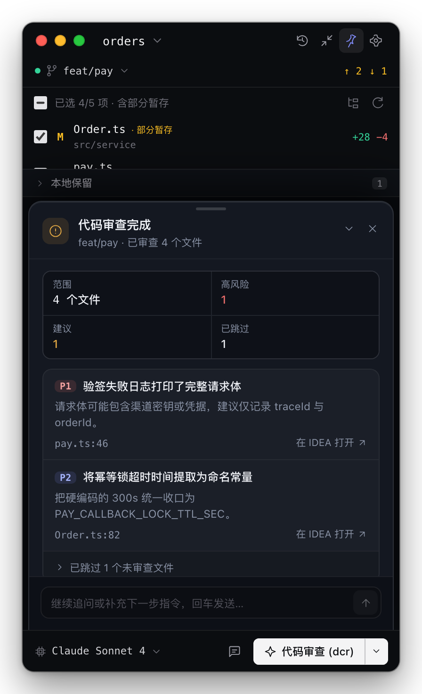
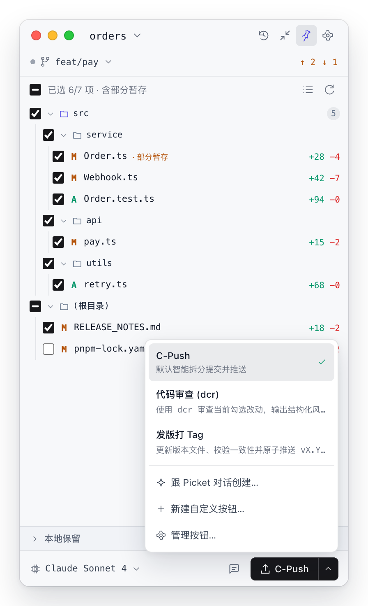
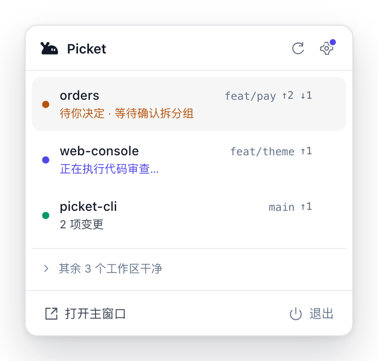
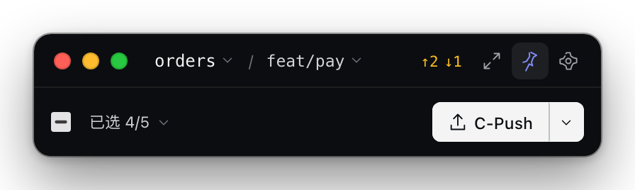
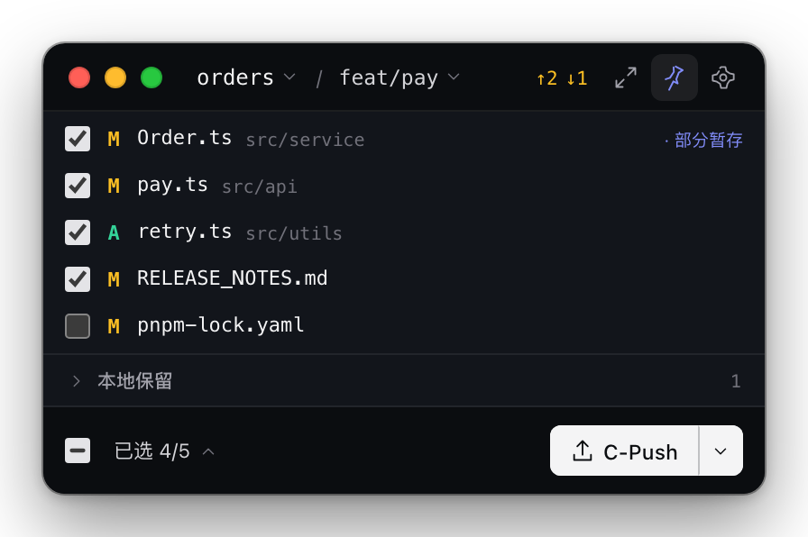

<p align="center">
  
</p>

<h1 align="center">Picket</h1>

<p align="center">
  <strong>贴靠在 IDE 侧边的 macOS 桌面端 Git Agent 与轻量本地服务管理器。</strong>
</p>

<p align="center">
  <a href="README.md">English</a> · <strong>简体中文</strong>
</p>

<p align="center">
  macOS 14+（Apple Silicon） · MIT 协议 · 中英双语 · 跟随系统 / 深色 / 浅色主题
</p>

---

**Picket** 安静地停靠在你的 IDE 旁边，接管日常 Git 提交与本地服务启停的繁琐操作。勾选这次要发出的文件并点击 **C-Push**，隔离运行的 **Pi Core** Agent 会按需读取授权范围内的差异，自动按语义拆分为规范的 Conventional Commits、生成清晰提交说明、严格按所选范围写入提交并推送到远端。

它只在真正需要你拍板时停下询问；未勾选文件、**本地保留**路径和 IDE 中未暂存的草稿始终逐字节原封不动。需要更复杂的协作流程时，可一键切换到仓库级 **自定义按钮**（`dcr` 代码审查、多阶段 `submit`、审 PR、发版打 Tag），或切到内置 **运行** 视图集中管理本地前后端开发服务。

<table>
  <tr>
    <td align="center" width="50%">
      <br />
      <sub><strong>主工作台</strong> · 精确范围勾选、本地保留与一键 C-Push</sub>
    </td>
    <td align="center" width="50%">
      <br />
      <sub><strong>统一浮层消息抽屉</strong> · 结构化风险定位、IDE 跳转与原位追问</sub>
    </td>
  </tr>
</table>

## 核心能力

### 精确范围 C-Push 与 Git 安全保障
- **一键 C-Push**：按需分析授权范围差异，自动拆分为 Conventional Commits、生成提交说明并推送；在底栏按需弹出的提示词框里输入一句要求（如“仅本地提交不推送”）即可灵活微调。
- **零暂存区污染**：勾选文件只决定本次提交范围，绝不暗中执行 `git add` / `git reset`。部分暂存文件默认只提交已暂存区块，未暂存草稿与未勾选的已暂存文件绝不混入。
- **本地保留（Local Keep）**：拖拽或右键将本机调试改动移入底部 **本地保留** 分组，在同仓库所有工作树中默认排除出 **全选**、**C-Push** 与自定义动作——不改 `.gitignore`、`.git/info/exclude`，也不碰 `skip-worktree` / `assume-unchanged`。
- **清爽视图与受控同步**：支持 **平铺列表 / 目录树视图**（目录级三态勾选）、IDEA 风格本地/远程分支与工作树菜单（外部变更自动热更新）、无损 **拉取并变基**、推送失败 **仅重试推送**（不重复提交），以及显式授权的 Agent 冲突合并或外部 IDE 接管对账。

### 统一动作引擎、自定义按钮与 Git 技能
- **统一会话引擎与浮层消息抽屉**：**C-Push**、**自定义按钮** 与 **拉取并变基** 共享一套会话协议、零 Token 宿主恢复交接和浮层消息抽屉（`MessageDock`），内置 7 种自适应深浅色主题的原生 UI 积木（安全 Markdown、提示条、指标卡片、可直达 IDE 的问题清单、检查清单、折叠代码块、文件胶囊），并支持完成后原位追问续跑。
- **自定义按钮与跨仓库选择性同步**：通过底栏 Split Button（完整与紧凑模式均可）一键切换仓库自定义按钮，工作区干净时同样可用；支持手动配置或与 Picket 自然语言对话生成，保存时可按仓库勾选批量同步。
- **三档全局操作确认模式**：在 **设置 → 通用 → 操作确认** 中统一切换 **`询问`** · **`自动`** · **`免确认`**，精细控制写操作确认弹窗；业务决策仍会停下询问，硬安全红线（禁止强制推送、禁止破坏性重置等）始终强制生效。
- **受控工具链与热同步技能**：直接复用本机 `gh` / `glab` 登录态，在隔离工作树中执行 `submit` 并支持冷重启恢复；内置 8 个离线 Git 技能（`commit`、`push`、`cpush`、`dcr`、`create-issues`、`create-pr`、`review-pr`、`submit`），可在 **设置 → 技能** 中逐项启停或从自定义仓库热同步。

<table>
  <tr>
    <td align="center" valign="middle" width="52%">
      <br />
      <sub><strong>浅色主题与自定义按钮</strong> · 目录树视图与底栏 Split Button 切换器</sub>
    </td>
    <td align="center" valign="middle" width="48%">
      <br />
      <sub><strong>状态栏后台常驻</strong> · 运行中服务控制与多仓库优先级状态弹窗</sub>
    </td>
  </tr>
</table>

### 轻量本地运行（Run）与独立日志窗口
- **`Git | 运行` 双视图（运行期零大模型）**：按仓库管理前端开发服务、后端 API、微服务与常用脚本（最多 64 条），完全独立于 Git 写锁；内置 12 套矢量语言图标、最新日志预览与可点击本地端口胶囊。
- **多模块 AI 扫描项目**：只读扫描单包及多模块工程（Maven / Spring Cloud、Gradle、pnpm/npm/yarn Workspace、Cargo、Go `go.work`、`Makefile`、`scripts/`）；大仓库自动提供 **运行中置顶区块**、可折叠分组与即时搜索过滤，也支持纯离线手动维护。
- **本机登录 Shell 环境与整组进程回收**：直接继承用户 `$SHELL` 环境（`nvm`、`fnm`、`volta`、`mise`、`pyenv`、`cargo`、Homebrew），绝不注入 Picket 模型 API Key；支持仓库 **共享环境变量**（配置 `JAVA_HOME` 时自动将 `<JAVA_HOME>/bin` 置顶到 `PATH`）与单命令覆盖。每个服务运行于独立 Unix 进程组（PGID），停止、启动中取消、重启或退出时干净回收整棵子进程树。
- **独立弹出运行日志窗口**：可复用的多标签原生 **运行日志** 窗口，支持容错 UTF-8 限长流式日志、可点击 `localhost` 链接与清空/停止操作；关闭主窗口或日志窗口时服务继续后台运行，可在顶部状态栏弹窗直接查看或停止。

### 置顶紧凑模式与 macOS 原生体验
- **置顶紧凑模式与顶栏双击切换**：双击主窗口顶部空白区域（或点击右上角切换按钮）即可在 **完整模式**（`400 × 700`）与 **紧凑模式**（约 `400 × 86` 两行悬浮条，内置项目、分支、远端同步、文件勾选、动作切换与运行服务抽屉）之间平滑切换；窗口置顶独立控制，自动跟随 macOS 普通桌面空间。
- **顶部状态栏后台常驻**：点红叉关闭主窗口时自动隐藏至顶部状态栏并收起 Dock 图标，进行中的任务与本地运行服务保持存活；点击菜单栏鲸鱼弹出状态小窗，实时展示运行中服务（直达日志 / 一键停止）与按优先级排序的仓库状态（超过 5 个仓库自动折叠干净工作区）。
- **自适应主题、IDE 直达与静默更新**：支持 **English / 简体中文** 即时切换与 **跟随系统 / 深色 / 浅色** 外观（冷启动跳跃小鲸鱼、主工作台、状态栏弹窗与运行日志窗全程同步），自动识别外部 IDE、仅在窗口失焦且需人工处理时发送 macOS 通知，并在 **设置 → 关于与更新** 提供 Ed25519 签名校验的应用内更新。

<table>
  <tr>
    <td align="center" valign="middle" width="50%">
      <br />
      <sub><strong>置顶紧凑模式</strong> · 两行悬浮条（<code>400 × ~86</code>）与 Split Button</sub>
    </td>
    <td align="center" valign="middle" width="50%">
      <br />
      <sub><strong>快捷抽屉</strong> · 无需展开大窗即可勾选文件、切分支/动作、启停服务或拉取变基</sub>
    </td>
  </tr>
</table>

## 典型使用流程

1. **打开仓库**：启动 Picket 并添加本地 Git 仓库（关联工作树与外部改动会自动热更新）。
2. **确认范围**：正常变更默认全选；取消勾选暂不提交的文件、切到 **目录树视图** 按目录批选，或把本机调试改动拖入 **本地保留**。双击文件可在首选 IDE 中查看 Diff。
3. **按需引导或切换（可选）**：点 **C-Push** 旁的提示词图标补充临时约束（如“仅本地提交不推送”），通过 Split Button 切换自定义按钮，或切到 **运行** 视图启停本地服务。
4. **一键执行**：点击 **C-Push**（或当前自定义按钮），Picket 自动完成拆分、提交、同步与推送，仅在需要决策、合并冲突或重试推送时提醒。

## 支持的模型提供商与外部 IDE

### 模型提供商

每个供应商连接只需配置一次接口地址与 API Key，即可在其下拉取远端模型列表并按需添加多个子模型。

| 提供商 | 默认接口格式 | 说明 |
| --- | --- | --- |
| **Anthropic** | Anthropic Messages (`/v1/messages`) | API Key 隔离存放于 `~/.picket/credentials.json`（`0600`） |
| **OpenAI** | OpenAI Responses (`/responses`) | 同时支持 Chat Completions |
| **DeepSeek** | OpenAI Chat Completions (`/chat/completions`) | API Key 隔离存放于 `~/.picket/credentials.json`（`0600`） |
| **Ollama（本地）** | OpenAI Chat Completions (`/chat/completions`) | 连接本地服务（如 `http://127.0.0.1:11434/v1`），无需 API Key |
| **自定义兼容** | 可自由选择 | 支持 OpenAI Chat Completions、OpenAI Responses 与 Anthropic Messages |

### 外部 IDE

macOS 下自动识别并支持按项目独立指定首选编辑器：**IntelliJ IDEA**、**RustRover**、**WebStorm**、**Visual Studio Code**、**Cursor**。

## 安全与隐私

- **统一的 `~/.picket/` 本地隔离存储**：本地状态使用 `0700` 目录与 `0600` 原子写入文件；API Key 单独存放于 `~/.picket/credentials.json`（按连接 ID 索引），绝不写入 `models.json`、会话历史、日志或前端状态。
- **本机认证查看密钥**：查看已保存的完整 API Key 必须通过 macOS **触控 ID** 或系统登录密码验证，且在 30 秒后或窗口失焦时自动隐藏并清除内存。
- **零隐式凭据**：首次启动处于零仓库、零模型的干净状态，绝不读取 Shell 环境变量中的 API Key 或外部开发工具登录态。
- **原生 Rust 受控执行**：所有 Git 写入、文件编辑与本地校验命令均由 Rust 桌面层核验执行，模型无法对仓库运行任意 Shell 命令。
- **复用现有本地认证**：推送、拉取及 `gh` / `glab` 操作直接复用你本机已有 Git/CLI 登录态，无需额外登录第三方账号。

## 快速开始

> **平台要求**：支持 **macOS 14.0+（Apple Silicon / `arm64`）**。可在 [GitHub Releases](https://github.com/dpbs-715/Picket/releases) 下载内测 `.dmg` 包（Ad-hoc 签名；拖入应用程序后首次启动前执行 `xattr -dr com.apple.quarantine /Applications/Picket.app`），或按下方步骤从源码运行与打包。

### 源码构建环境

- macOS 14.0+（Apple Silicon / `arm64`）与 Xcode Command Line Tools（`xcode-select --install`）
- [Node.js](https://nodejs.org/) `24.17.0` 与 [pnpm](https://pnpm.io/) `10.28.1`
- 通过 [rustup](https://rustup.rs/) 安装的 Rust `1.100.0`（版本固定于 [rust-toolchain.toml](rust-toolchain.toml)）

### 本地运行与打包

```bash
git clone https://github.com/dpbs-715/Picket.git
cd Picket
pnpm install --frozen-lockfile

# 桌面开发模式启动
pnpm desktop dev

# 构建独立 macOS .app 应用包
pnpm desktop build
```

打包产物位于 `src-tauri/target/release/bundle/macos/Picket.app`。

## 架构与开发

基于 **Tauri 2（Rust）**、**React 19 + TypeScript** 与独立的 **Pi Core** 侧车进程构建：

- `src/` — React 工作台界面、紧凑模式、状态栏弹窗、独立运行日志窗口与 `src/desktop/` 类型化 IPC 封装。
- `shared/` — 共享通信协议与 Rust 生成的 TypeScript 契约（`shared/generated/`，通过 `pnpm protocol:sync` 同步）。
- `agent/` — 随包 Pi Core 侧车运行时、执行策略配置、工具循环护栏与内置 Git 技能。
- `src-tauri/` — 原生 Rust 桌面协调层，负责 Git 读写、统一动作会话、本地 Run 进程组、窗口动效、状态栏托盘、凭据隔离与签名更新。

常用校验命令（完整架构说明与开发不变量请参阅 [AGENTS.md](AGENTS.md)）：

```bash
pnpm check                  # 协议一致性校验、TypeScript 类型检查、Vitest、Rust fmt/clippy 与单测
pnpm ui:verify              # 无头 Chrome 界面交互与布局回归套件
pnpm package:verify --ui    # 针对打包后的 macOS .app 执行端到端真机验证
```

## 开源协议

基于 [MIT License](LICENSE) 开源。
