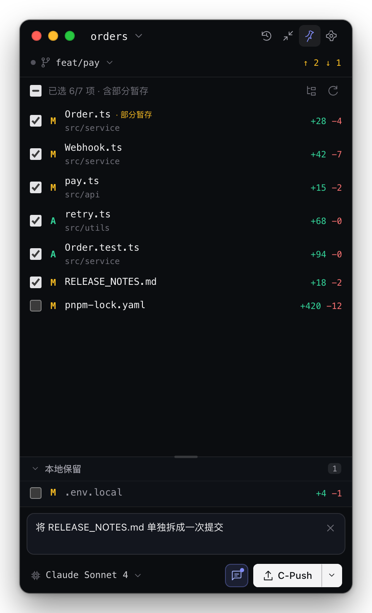

<p align="center">
  
</p>

<h1 align="center">Picket</h1>

<p align="center">
  <strong>面向 macOS 的桌面端 Git Agent：精确圈定变更范围，一键完成拆分、提交、推送与自定义 Git 工作流。</strong>
</p>

<p align="center">
  <a href="README.md">English</a> · <strong>简体中文</strong>
</p>

<p align="center">
  macOS 14+（Apple Silicon） · MIT 协议 · 中英双语 · 跟随系统 / 深色 / 浅色主题
</p>

---

**Picket** 安静地停靠在你的 IDE 旁边，帮你接管 Git 提交与推送的“最后一公里”。选定本次要发出的文件，点一下 **C-Push**，Picket 会通过隔离的 **Pi Core** Agent 循环按需读取授权范围内的差异，自动按语义分组、生成规范的 Conventional Commits 提交说明、严格按所选范围写入提交并推送到远端（也支持按提示词仅本地提交不推送）。

它只在真正需要你拍板时停下询问；未勾选的文件、**本地保留**文件以及 IDE 中尚未暂存的草稿始终逐字节原封不动。当你需要更丰富的协作流程（如 `dcr` 代码审查、多阶段 `submit`、审 PR 或发版打 Tag）时，可在底栏 Split Button 切换至仓库级 **自定义按钮**，并通过 Picket 统一的 **浮层消息抽屉** 完成结构化阅读与交互。

<table>
  <tr>
    <td align="center" width="50%">
      <br />
      <sub><strong>主工作台</strong> · 精确范围勾选、本地保留与一键 C-Push</sub>
    </td>
    <td align="center" width="50%">
      <br />
      <sub><strong>统一浮层消息抽屉</strong> · 结构化风险定位、IDE 跳转与原位追问</sub>
    </td>
  </tr>
</table>

## 核心能力

### 一键 C-Push 与更清爽的工作台布局
- **自动拆分、提交与推送**：勾选要提交的文件后点击 **C-Push**，Picket 的 Pi Core Agent 循环会按需读取授权范围内的代码差异，按 Conventional Commits 规范自动拆分为清晰的提交并推送至远端；如需仅本地提交，可在提示词中直接说明（如“只提交不推送”）。
- **只在必要时打断**：不为每次常规提交增加多余确认弹窗；仅在归属不明确、涉及敏感文件或缺少远端跟踪分支等真正需要决定的场景暂停询问。
- **全高变更列表、目录树视图与零占位提示词**：支持在 **平铺列表** 与 **目录树视图**（带目录级三态勾选与缩进引导线）之间一键切换；闲时文件列表直接铺满主工作区，需要补充约束时点击底栏 **C-Push** 左侧图标即可滑出圆角提示词框。

### 精确范围安全与「本地保留」
- **勾选绝不改写暂存区**：在 Picket 中勾选或取消勾选文件仅控制本次范围，绝不会在后台执行 `git add` 或 `git reset`。
- **完整保留部分暂存草稿**：同一文件既有已暂存改动又有未暂存改动时，默认只提交已暂存的部分，工作区中的未暂存草稿逐字节保留在原处。
- **未选中的已暂存文件绝不混入**：即使某些文件已经在 Git 中暂存，只要未在 Picket 中勾选，就不会被带入本次提交。
- **本地保留（Local Keep）**：将仅在本机使用的配置或调试改动拖入底部的 **本地保留** 分组（或右键单选 / 多选移入），即可在同一仓库的所有工作树中默认将其排除在 **全选**、**C-Push** 与自定义动作之外——全程不修改 `.gitignore`、`.git/info/exclude`，也不设置 `skip-worktree` 或 `assume-unchanged`。

### 统一交互消息抽屉（`message_user`）
- **结构化双向沟通**：Pi Core 通过统一的 `message_user` 工具驱动 macOS 风格浮层消息抽屉（`MessageDock`），既可在不打断流程的前提下展示进度与结构化报告（如 `dcr` 代码审查结果、发版校验清单），也可在需要决策时挂起等待选择或补充输入。
- **7 种自适应主题原生 UI 积木**：支持安全 Markdown、提示条（Callout）、内凹分段摘要指标（Facts）、分级问题清单（Findings，点击条目或文件标签直达首选 IDE 对应 `path:line`，工作区干净时也可用）、状态检查清单（Checklist）、自动折叠且支持复制的代码块（Code）与文件胶囊（Files），深浅色主题原生适配，零原始 HTML 注入风险。
- **专注阅读与原位追问**：拖动顶部抓手平滑调整抽屉高度（拖到顶自动吸附铺满、双击快速还原并记住偏好），执行中进度条固定置顶、指令日志独立滚动跟随最新步骤，自定义动作结束后支持原位追问续跑，右上角 `×` 一键关闭已完成卡片。

### 仓库级自定义按钮与热同步 Git 技能
- **主按钮切换器（完整与紧凑模式）**：默认保留 **C-Push** 主按钮，可在完整模式底栏 Split Button 与紧凑模式抽屉中一键切换到当前仓库绑定的自定义按钮（如 `dcr` 代码审查、多阶段 `submit`、审 PR 或发版打 Tag），工作区干净时同样可直接触发。
- **跟 Picket 对话创建与按需勾选同步**：支持手动编写按钮指令，或用自然语言跟 Picket 对话，由其读取仓库分支、Tag 习惯与发版脚本自动生成配置；保存时支持 **全选 + 按仓库勾选** 同步目标（实时展示 `已同步 / 将更新 / 同名 / 已满` 状态），点击 **保存并同步** 时原子生效。
- **受控工作区编辑、`gh` / `glab` 与 `submit` 断点恢复**：自定义按钮可安全修改或新建授权文件（`edit_repo_file`、`write_repo_file`）、运行离散本地校验命令（`run_repo_command`，禁止任意 Shell 拼接）并仅提交跟踪路径（`commit_exact_scope`），绝不污染未勾选草稿与本地保留文件；同时复用本机 `gh` / `glab` 登录态、强制硬红线与高危命令预览（支持绑定指令指纹的「此按钮不再提示」），并在隔离工作树中执行 `submit` 且支持冷重启恢复。
- **内置与热同步技能（设置 → 技能）**：随包离线内置 8 个 Git 协作技能（`commit`、`push`、`cpush`、`dcr`、`create-issues`、`create-pr`、`review-pr`、`submit`），支持按需热同步默认源或自定义 `SKILL.md` 仓库到 `~/.picket/skills/`、逐项启停或一键恢复内置版本。

<table>
  <tr>
    <td align="center" valign="middle" width="52%">
      <br />
      <sub><strong>浅色主题与自定义按钮</strong> · 目录树视图与底栏 Split Button 切换器</sub>
    </td>
    <td align="center" valign="middle" width="48%">
      <br />
      <sub><strong>状态栏后台常驻</strong> · 多仓库优先级状态弹窗，绝不弹出 Dock</sub>
    </td>
  </tr>
</table>

### 分支、工作树热更新与受控恢复
- **IDEA 风格分支菜单与工作树自动热更新**：在一个收拢的菜单中切换本地分支、检出远程跟踪分支，或直接跳转到关联工作树。外部终端增删工作树、切换分支及文件改动均会自动热更新，无需手动刷新。`main` / `master` 在菜单内展示轻量 **保护分支** 标签但不阻断直接提交；处于分离 `HEAD` 时会提示先切回本地分支。
- **无损拉取并变基**：支持显式 **拉取并变基** 与 C-Push 内置远端同步，在变基过程中无损保全无重叠的已暂存和未暂存改动，不依赖有风险的自动 stash。
- **推送失败仅重试推送**：如果本地提交已成功但远端推送失败，已完成提交和提示词均完整保留；点击 **重试推送** 只会推送已有提交，不会重复创建提交。
- **受控冲突处理**：变基遇到冲突时，可明确授权 Agent 仅合并当前冲突文件（合并后强制校验冲突标记与路径边界），也可在外部 IDE 中手动合并后切回 Picket 自动对账继续。
- **绝不越界**：永不自动强制推送（`--force`）、永不丢弃用户未提交改动、永不静默改写已发布的远端历史。

### 轻量本地运行（Run）进程管理与弹出日志窗口
- **执行期零大模型、独立于 Git 写锁**：在主工作台顶栏通过 **Git / 运行** 分段切换进入专属服务面板（或在紧凑模式快捷运行区一键启停），管理前端开发服务器、后端 API、微服务或 `pnpm desktop dev --no-watch` 等常驻本地服务，内置 12 套矢量语言图标、实时最新输出预览与可点击端口胶囊；按仓库独立配置（最多 64 条且默认 0 条），服务运行期间完全不阻塞 `C-Push`、切分支与拉取变基。
- **严格使用本机用户环境、仓库共享变量与整组进程回收**：直接从本机登录 Shell（`$SHELL`，自动继承 `nvm`、`fnm`、`volta`、`mise`、`pyenv`、`cargo`、Homebrew 等）拉起命令，**绝不回退到随包 `picket-node`**，且**绝不注入 Picket 模型 API Key**。支持为每个仓库单独配置 **共享环境变量**（如 `JAVA_HOME`、`SPRING_PROFILES_ACTIVE`、`MAVEN_OPTS`，设置 `JAVA_HOME` 时自动将 `<JAVA_HOME>/bin` 置顶到 `PATH`），单条命令变量可按需覆盖。每个服务运行在独立 Unix 进程组（PGID）中，停止、重启或退出时彻底回收整棵子进程树，避免残留占端口。
- **多模块 AI 扫描与分层分组列表**：支持离线手动增删改，也可点击 **AI 扫描项目** 只读递归解析单模块及多模块工作区（Maven / Spring Cloud 多层父 POM 与 `@SpringBootApplication` 启动模块、Gradle 多子项目、pnpm/npm/yarn Workspace、Cargo Workspace、Go `go.work`、`Makefile`、`scripts/`），按分组打勾多选导入（如 `Maven` 主包 `install -DskipTests` 与各 `Spring Boot` 子服务）。大项目自动开启 **运行中置顶区块**、**可折叠分组紧凑行** 与 **快速过滤框**，小项目仍保持清爽平铺卡片。
- **独立弹出日志窗、后台常驻与退出前确认**：点击服务旁的「日志」小按钮按需弹出可复用的多标签 **运行日志** 窗口，实时流式展示输出、自动提取可点击的本地 `localhost` 地址并提供清空 / 重启 / 停止操作；关闭主窗口或日志窗口时服务继续在后台运行（菜单栏托盘可直接查看运行中服务、直达日志或一键停止），完全退出 Picket 前若有活跃服务则弹窗确认并统一干净回收。

### 置顶紧凑模式、外观主题与 macOS 原生联动
- **贴合 IDE 侧边使用**：完整模式与紧凑模式右上角常驻「紧凑模式切换 / 置顶 / 设置」三键，窗口置顶（开启时自动跟随切换 macOS 普通桌面空间）与收起为约 `400 × 86` 两行紧凑条各自独立控制，紧凑模式下可随时展开抽屉切换项目、分支、自定义按钮、本地运行服务、拉取变基或勾选文件。
- **macOS 顶部状态栏后台常驻**：点红叉关闭主窗口时自动隐藏至顶部状态栏并收起 Dock 图标（进行中的任务、运行中的本地服务与未发提示词完整保留）；点击状态栏鲸鱼图标原地弹出极简状态小窗且绝不弹出 Dock，顶部实时展示运行中服务（支持直接 **停止** 或跳转日志窗口），同时自动将待处理与有变更项目置顶、超过 5 个仓库时自动折叠干净工作区，底部直达「打开主窗口」与「退出」。
- **自适应外观主题与启动小鲸鱼**：支持 **English** / **简体中文** 即时切换与 **跟随系统 / 深色 / 浅色** 三种外观模式，冷启动跳跃小鲸鱼（深色珍珠白鲸 / 浅色雾霾深海蓝）、主工作台、紧凑小窗口、状态栏弹窗与 macOS 原生窗口外观保持全程一致；同时支持按项目独立设置 **首选编辑器** 与 **提交说明语言**。
- **不打扰的后台通知与 IDE 直达**：仅在窗口失焦且需要你处理（待决定、冲突或推送失败）时发送原生 macOS 通知；自动检测本机已安装 IDE（`IntelliJ IDEA`、`RustRover`、`WebStorm`、`VS Code`、`Cursor`），一键打开文件、Diff、已暂存 Diff、审查行号与冲突合并视图。
- **静默应用内更新**：在 **设置 → 关于与更新** 中提供单通道版本检查与一键更新，发现新版本时仅在设置按钮右上角显示轻量小蓝点，支持下载进度、Ed25519 签名校验、活跃 Git 任务防打断保护与安全重启（也可直接前往 GitHub Releases 下载）。

<table>
  <tr>
    <td align="center" valign="middle" width="50%">
      <br />
      <sub><strong>置顶紧凑模式</strong> · 两行悬浮条（<code>400 × ~86</code>）与 Split Button</sub>
    </td>
    <td align="center" valign="middle" width="50%">
      <br />
      <sub><strong>快捷抽屉</strong> · 无需展开大窗即可勾选文件、切分支、切动作或拉取变基</sub>
    </td>
  </tr>
</table>

## 典型使用流程

1. **打开本机仓库**：启动 Picket 并打开任意本地 Git 仓库（关联工作树与外部改动会自动热更新）。
2. **确认本次范围**：正常变更默认自动全选；取消勾选暂不提交的文件、切换到 **目录树视图** 按目录批选，或把本机临时改动拖入 **本地保留**。双击文件或点 **Diff** 可在 IDE 中查看详情。
3. **补充提示词或切换动作（可选）**：点击底栏 **C-Push** 左侧的提示词图标补充临时要求（如“仅本地提交不推送”），或通过 Split Button 切换为自定义按钮（如 `dcr` 代码审查、`submit` 提 PR 或发版打 Tag）。
4. **一键触发**：点击 **C-Push**（或当前自定义按钮），Picket 自动完成拆分、提交、同步与推送；仅在需要你决策、解决冲突或重试推送时提醒。

## 支持的模型提供商与编辑器

### 模型提供商

每个供应商连接只需配置一次（接口地址与 API Key），随后可在该连接下按需拉取远端模型列表并添加任意模型。Picket 通过隔离的随包 Pi Core 运行时发起调用。

| 提供商 | 默认接口格式 | 说明 |
| --- | --- | --- |
| **Anthropic** | Anthropic Messages (`/v1/messages`) | API Key 以 `0600` 权限存于 `~/.picket/credentials.json` |
| **OpenAI** | OpenAI Responses (`/responses`) | 同时支持 Chat Completions |
| **DeepSeek** | OpenAI Chat Completions (`/chat/completions`) | API Key 以 `0600` 权限存于 `~/.picket/credentials.json` |
| **Ollama（本地）** | OpenAI Chat Completions (`/chat/completions`) | 连接本地服务（如 `http://127.0.0.1:11434/v1`），无需 API Key |
| **自定义兼容** | 可自由选择 | 支持 OpenAI Chat Completions、OpenAI Responses 与 Anthropic Messages |

### 外部 IDE

Picket 自动识别本机已安装的以下编辑器，并支持按项目独立配置首选编辑器：

- **IntelliJ IDEA**
- **RustRover**
- **WebStorm**
- **Visual Studio Code**
- **Cursor**

## 安全与隐私

- **统一的 `~/.picket/` 本地数据与凭据隔离**：Picket 所有配置统一保存在 `~/.picket/`（目录 `0700`，文件 `0600`）。API Key 单独存放在 `~/.picket/credentials.json`（`0600` 仅本机用户可读），绝不写入 `models.json`、`workbench-state.json`、会话历史、日志或前端状态。
- **供应商配一次，模型按需添加**：同一连接下的子模型自动复用连接地址与 API Key，轮换连接密钥时该连接下所有模型立即生效。在 **编辑连接** 中查看完整密钥仍须通过 macOS 本机身份验证（**触控 ID** 或系统登录密码），并在 30 秒后或窗口失焦时自动隐藏并清除内存。
- **零隐式凭据**：首次启动处于零仓库、零模型的干净状态，绝不读取 Shell 环境变量中的密钥或外部工具登录态。
- **受控的本地执行**：所有 Git 写入、文件编辑与本地校验命令均由原生 Rust 桌面层核对并执行，模型无法对仓库执行任意 Shell 命令。
- **复用现有 Git 认证**：远端拉取、推送与 `gh` / `glab` 操作直接复用本机已有认证配置，无需额外登录第三方账号。

## 快速开始

> **平台说明**：支持 **macOS 14.0+（Apple Silicon / `arm64`）**。可在 [GitHub Releases](https://github.com/dpbs-715/Picket/releases) 下载内测 `.dmg` 安装包（Ad-hoc 签名；拖入应用程序后首次启动前执行 `xattr -dr com.apple.quarantine /Applications/Picket.app`），也可按下方步骤从源码本地运行或打包。

### 环境要求（从源码构建）

- macOS 14.0 及以上（Apple Silicon / `arm64`）
- Xcode Command Line Tools（`xcode-select --install`）
- [Node.js](https://nodejs.org/) `24.17.0`
- [pnpm](https://pnpm.io/) `10.28.1`
- 通过 [rustup](https://rustup.rs/) 安装的 Rust（工具链版本固定于 [rust-toolchain.toml](rust-toolchain.toml)）

### 本地运行与打包

```bash
git clone https://github.com/dpbs-715/Picket.git
cd Picket
pnpm install --frozen-lockfile

# 以桌面开发模式启动
pnpm desktop dev

# 或构建独立的 macOS .app 应用包
pnpm desktop build
```

打包完成的应用位于 `src-tauri/target/release/bundle/macos/Picket.app`。

### 首次使用

1. 点击 **打开本机仓库…** 选择你的 Git 工作目录。
2. 点击 **配置模型**（或打开 **设置**），添加模型提供商、拉取或选择模型并点击 **测试连接**。
3. 确认勾选文件范围，点击 **C-Push** 即可体验。

## 开发与贡献

基于 **Tauri 2（Rust）**、**React + TypeScript** 与独立的 **Pi Core** 侧车进程构建（`src/` 模块化工作台 Hooks 与界面、`shared/` 类型化通信协议、`agent/` Pi Core 运行时与技能、`src-tauri/` Rust 仓库 / 自定义动作 / 窗口动效 / 状态栏 / 更新器等模块）。

- 仓库架构、核心不变量、验证命令与协作规范请参阅 [AGENTS.md](AGENTS.md)。
- 运行 `pnpm check` 可执行 TypeScript 类型检查、Node 测试、Rust 格式与 Clippy 检查以及 Rust 集成测试；运行 `pnpm ui:verify` 可执行无头 Chrome 界面回归测试。

## 开源协议

基于 [MIT License](LICENSE) 开源。
